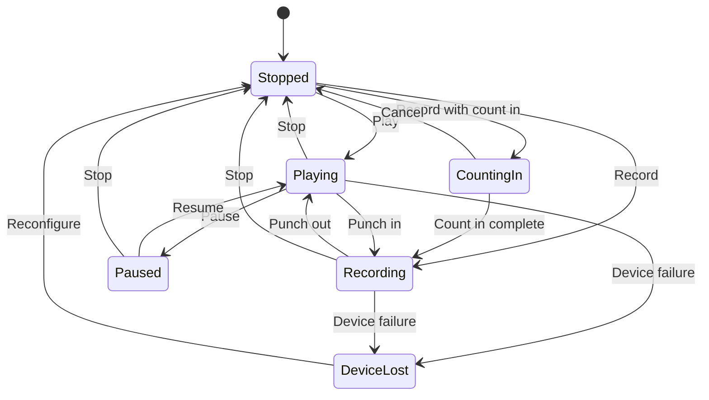
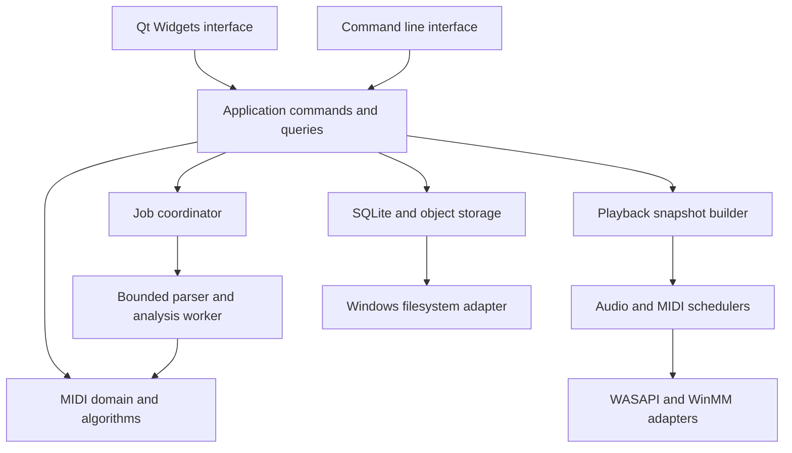

# MIDI Workbench Full Product and Engineering Specification

Version 1.1 · 19 October 2026 · Target platform Windows x64 · License GPL-3.0

Version 1.1 folds in the engineering lessons from building Music Sample Organizer with the same stack: a binding dependencies-first rule (section 4.4), the vendoring and patch workflow, the repository layout, toolchain presets, CI, the UI responsiveness contract (section 19.4), documentation and agent guidance, and the review process. The product content of version 1.0 is unchanged except where a section says so.

This document defines an offline desktop application for creating, recording, inspecting, editing, auditioning, organizing, and searching MIDI. It is an implementation contract for an engineer or coding agent: product behavior, data ownership, algorithms, interfaces, storage, failure handling, verification, and release criteria are specified together.

The primary workflow is **find or create a musical idea, edit it comfortably, hear it immediately, save it without losing information, and reuse it in a DAW**. The piano roll, scale tools, MIDI keyboard, and searchable personal library are equally important parts of the product.

The required stack is **C++23, Qt 6, SQLite, Clang, LLVM tools, and LLVM libc++**, built with **CMake presets and Ninja**. Everything a maintained, GPL-3.0-compatible library already does is done by that library (section 4.4). The Windows build uses the **Universal C Runtime (UCRT)** underneath libc++. LLVM libc is a different project and is not a production replacement for the complete Windows C runtime in this specification. Section 4 explains the verified toolchain choice and its acceptance gate.

All numerical performance figures below are **engineering targets, not measured results**. Behavior marked MUST is required for the finished v1 product. The roadmap schedules the implementation; a feature appearing in a later v1 phase is still required for v1. Explicit v2 extensions are outside v1 acceptance.

## Contents

- [1 Product definition and boundaries](#1-product-definition-and-boundaries)
- [2 Terminology and ownership](#2-terminology-and-ownership)
- [3 Requirements and acceptance map](#3-requirements-and-acceptance-map)
- [4 Platform and toolchain contract](#4-platform-and-toolchain-contract)
- [5 End-to-end workflows](#5-end-to-end-workflows)
- [6 Workspace and navigation](#6-workspace-and-navigation)
- [7 Piano roll editor](#7-piano-roll-editor)
- [8 MIDI keyboard and recording](#8-midi-keyboard-and-recording)
- [9 Scale and harmony tools](#9-scale-and-harmony-tools)
- [10 Note and rhythm transformations](#10-note-and-rhythm-transformations)
- [11 Drum grid and controller editing](#11-drum-grid-and-controller-editing)
- [12 Track and song editing](#12-track-and-song-editing)
- [13 Playback and sound](#13-playback-and-sound)
- [14 External MIDI and DAW interoperability](#14-external-midi-and-daw-interoperability)
- [15 Audio rendering and preview cache](#15-audio-rendering-and-preview-cache)
- [16 MIDI format and preservation contract](#16-midi-format-and-preservation-contract)
- [17 Time and musical coordinate model](#17-time-and-musical-coordinate-model)
- [18 Native document model](#18-native-document-model)
- [19 Application architecture](#19-application-architecture)
- [20 Concurrency and real-time ownership](#20-concurrency-and-real-time-ownership)
- [21 Command history and recovery](#21-command-history-and-recovery)
- [22 Storage layout and atomic workflows](#22-storage-layout-and-atomic-workflows)
- [23 Database schemas](#23-database-schemas)
- [24 Library behavior and metadata](#24-library-behavior-and-metadata)
- [25 Text and structured search](#25-text-and-structured-search)
- [26 Musical content search](#26-musical-content-search)
- [27 Analysis and duplicate detection](#27-analysis-and-duplicate-detection)
- [28 Jobs, parser isolation, and input limits](#28-jobs-parser-isolation-and-input-limits)
- [29 Windows files, preferences, and accessibility](#29-windows-files-preferences-and-accessibility)
- [30 Backup, restore, repair, and diagnostics](#30-backup-restore-repair-and-diagnostics)
- [31 Command-line interface](#31-command-line-interface)
- [32 Build system, repository, and release pipeline](#32-build-system-repository-and-release-pipeline)
- [33 Performance and capacity targets](#33-performance-and-capacity-targets)
- [34 Verification strategy](#34-verification-strategy)
- [35 Implementation roadmap](#35-implementation-roadmap)
- [36 Finished v1 acceptance checklist](#36-finished-v1-acceptance-checklist)
- [37 Architectural decisions and extension boundaries](#37-architectural-decisions-and-extension-boundaries)
- [38 Reference sources](#38-reference-sources)

## 1 Product definition and boundaries

### 1.1 Product capabilities

MIDI Workbench MUST provide:

1. A responsive, multi-document MIDI editor with a feature-rich piano roll, drum grid, event list, and controller lanes.
2. Musical composition tools: scales, modes, chords, arpeggios, rhythm generation, transformations, and reusable templates.
3. An on-screen piano, a computer-keyboard playing mode, physical MIDI keyboard input, step recording, and real-time recording.
4. Immediate sound through an internal synthesizer, optional SoundFont 2 instruments, and configurable external MIDI output.
5. A managed local library with folders, tags, favorites, ratings, collections, revisions, import, export, backup, and recovery.
6. Search by text and musical content, including notes, intervals, rhythms, instruments, keys, tempo, length, and similar phrases.
7. Standards-aware MIDI import and export with explicit preservation rules and loss reports.
8. A keyboard-efficient Windows interface with customizable layouts and shortcuts, accessible controls, high-DPI support, and reliable undo.
9. A headless command-line interface using the same parser, transformations, analysis, and export implementations as the GUI.

### 1.2 Deliberate product boundaries

The v1 application is a MIDI composition and library workbench. Its song editor is a multi-track linear event timeline. Named regions and reusable library phrases provide organization; inserting a phrase materializes its events into the destination document.

The following belong to possible v2 work and MUST NOT become dependencies of v1 delivery:

- Audio recording, waveform editing, audio time stretching, or a full mixing console.
- VST3/CLAP hosting, plugin scanning, plugin sandboxing, or an effect rack.
- A non-destructive clip arrangement graph with live references between projects.
- MIDI 2.0 UMP authoring, MIDI-CI, MPE-specific editing, microtonal tuning, and notation engraving.
- Cloud accounts, collaboration, synchronization, online content marketplaces, or AI generation.
- Ableton-specific private project formats, proprietary clipboard formats, and an in-process DAW extension.
- Linux, macOS, ARM64, and 32-bit Windows release support. The code nevertheless stays Linux-buildable: platform code is isolated (section 4.6), so a Linux build of the core, CLI, and worker is a configuration change, not a port.

Preserving MIDI 1.0 events that happen to be used by an MPE performance does not constitute MPE support. Likewise, a channel-10 drum label does not make the internal synth a certified General MIDI implementation.

### 1.3 Definition of a useful first release

The first usable milestone MUST let the user draw a four-bar phrase, hear it, transpose it, save it as `.mid`, reopen it with identical supported musical meaning, and undo an edit. Each subsequent phase MUST preserve that working path.

The finished v1 MUST additionally satisfy every requirement and acceptance row in sections 3 and 36. A collection of dialogs, placeholder buttons, or undocumented algorithms does not satisfy a requirement.

## 2 Terminology and ownership

| Term | Exact meaning |
|---|---|
| Document | One editable native project, optionally imported from an SMF. It contains one or more independent sequences. |
| Sequence | One independent timeline, time division, track set, tempo map, and meter map. Type-2 SMF tracks import as separate sequences. |
| Track | An ordered event container with a name, color, presentation settings, and routing policy. Track and MIDI channel are different concepts. |
| Event | A timed MIDI channel message, meta event, or SMF SysEx packet. |
| Note span | A view of a note-on and its paired note-off, identified by a stable note ID. Orphan messages remain events. |
| Region | A named half-open time range and track selection within a sequence. Regions do not own duplicate events. |
| Phrase | A region or selection extracted as an independent reusable library asset. |
| Asset | A user-visible library item with stable identity, descriptive metadata, and revision history. |
| Revision | An immutable saved version of an asset, referring to immutable content bytes. |
| Object | A content-addressed file containing exact `.mid` bytes or a native `.mwb` snapshot. |
| Source | An external file location from which content was imported. A source is provenance, not the library's only copy. |
| Analysis | Rebuildable derived information tied to a particular revision and algorithm version. |
| Recovery journal | Local durable working-session data used to recover edits since the last explicit save. |
| Project scale | A user-selected composition constraint; it is distinct from an imported key signature and an estimated key. |
| Route | A logical destination plus a MIDI channel. Events on a shared route share channel state. |

Content ownership rules:

- Import copies bytes into the managed library. Deleting or disconnecting the source MUST NOT remove the stored asset.
- Editing a library asset creates a working document. Saving creates a new immutable revision; existing revisions remain unchanged.
- Changing tags or a rating changes catalog metadata, not MIDI content and not its content hash.
- Saving an ordinary document outside the library does not import it automatically.
- Export never overwrites the original imported file unless the user explicitly chooses that path and confirms the standard overwrite dialog.
- MIDI is performance/control data. SoundFont files, synthesis settings, and hardware determine the sound; `.mid` does not embed an audio recording.

## 3 Requirements and acceptance map

Requirement IDs are stable references for issues, implementation commits, and tests. A feature may be split into smaller implementation tasks without renaming its parent requirement.

| ID | Required outcome | Acceptance evidence | Delivery |
|---|---|---|---|
| WB-001 | Create, open, save, duplicate, and recover documents | New/open/save/reopen and crash-recovery fixtures | P1–P2 |
| WB-002 | Import SMF 0/1/2 and PPQ/SMPTE timing safely | Codec conformance corpus and preservation report | P1, P6 |
| WB-003 | Export supported SMF profiles deterministically | Semantic round trips and DAW interchange matrix | P1, P6 |
| WB-004 | Ergonomic piano roll and multi-track navigation | Interaction tests and timed manual tasks | P2 |
| WB-005 | On-screen and computer keyboard audition | Focus-loss, release, octave, sustain, and routing tests | P2 |
| WB-006 | Physical MIDI keyboard input and recording | Loopback timing and device disconnect tests | P3 |
| WB-007 | Scale highlighting, folding, and pitch tools | Exact scale masks and non-destructive mode tests | P2, P4 |
| WB-008 | Chord, arpeggio, rhythm, and variation tools | Golden fixtures, fixed seeds, and undo tests | P4 |
| WB-009 | Velocity, release velocity, CC, bend, and pressure editing | Lane/event consistency and export tests | P2, P4 |
| WB-010 | Stable playback, seeking, looping, and note cleanup | Synthetic clock tests and hardware/audio endurance tests | P1, P3 |
| WB-011 | Native project format and immutable library revisions | Schema, migration, crash-injection, and revision tests | P2, P5 |
| WB-012 | Import and organize large libraries incrementally | Catalog benchmark and interrupted-import recovery | P5 |
| WB-013 | Search text, filters, and saved searches | Query grammar, correctness, and latency tests | P5 |
| WB-014 | Search melodies, intervals, rhythms, and similar phrases | Labeled retrieval corpus and match highlighting | P6 |
| WB-015 | Duplicate detection with explained equivalence | Exact and musical fingerprint fixtures | P5–P6 |
| WB-016 | Safe external MIDI and DAW handoff | Output routing, panic, and drag/drop matrix | P3, P6 |
| WB-017 | Deterministic offline WAV rendering | Sample-count, repeatability, tail, and clipping checks | P4 |
| WB-018 | Responsive and accessible Qt interface | DPI, keyboard-only, screen reader, and load tests | P2, P7 |
| WB-019 | Reproducible Windows toolchain and packaging | Clean-machine build and portable package smoke tests | P0, P7 |
| WB-020 | Meaningful CLI and local diagnostics | CLI contract tests and redacted support bundle | P1–P7 |
| WB-021 | Backup, restore, migration, trash, and repair | Failure-injection and restore rehearsal | P5, P7 |
| WB-022 | Entire production workflow works offline | Network-disabled installation/use test | P7 |

## 4 Platform and toolchain contract

### 4.1 Windows baseline

- Architecture: x86-64, little endian; distributed application is a native Windows executable.
- Supported baseline: Windows 11 24H2 or newer versions explicitly covered by the release test matrix. No Windows 10 support claim in v1.
- Minimum intended hardware: four CPU cores, 8 GiB RAM, and an SSD. Performance targets use the stronger reference machine in section 33.
- Graphics: integrated GPU is sufficient. No CUDA, Vulkan, or dedicated GPU requirement.
- DPI awareness: Per-Monitor V2. Long-path awareness enabled in the executable manifest.
- Standard user installation and operation; no administrator requirement for ordinary use.

### 4.2 Compiler and runtime decision

Use **MSYS2 CLANG64** as the initial coherent dependency environment. Its documented stack is LLVM/Clang, LLD, libc++, and UCRT [S1]. A CLANG64 Qt 6 base package is available [S2]. This is a project-supported configuration that MUST pass P0; availability of a package is not a claim that the exact combination has Qt vendor support.

| Layer | Required choice |
|---|---|
| Language | C++23 for application/core; C for SQLite amalgamation and C dependencies |
| Compiler driver | CLANG64 `clang++` / `clang`, targeting x86_64 Windows MinGW |
| Optimizer and linker | LLVM and LLD |
| C++ standard library | LLVM libc++ from the same CLANG64 toolchain |
| C runtime | Windows UCRT with matching mingw-w64 support files |
| Compiler support libraries | Toolchain-matched compiler-rt/unwind components as required by its distribution |
| GUI | Qt 6 Core, Gui, Widgets; Test for tests |
| Persistence | Vendored SQLite amalgamation, accessed through SQLiteCpp (section 4.4) |
| Build | CMake 3.28+ and Ninja with checked-in configure, build, and test presets |
| Code tooling | clang-format (version pinned in CI), clang-tidy, clangd, LLVM coverage/profiling tools |
| Editor integration | `CMAKE_EXPORT_COMPILE_COMMANDS`; a checked-in `.clangd` pointing at `build/debug` and editor settings (for example `.zed/settings.json`) so clangd sees the real flags |
| License | GPL-3.0 for the application; every dependency must be GPL-3.0-compatible |

LLVM libc and LLVM libc++ are not interchangeable names. LLVM's own platform documentation describes Windows libc support as partial [S3]. Do not add `-lc` or substitute LLVM libc artifacts and assume that Qt, Windows APIs, locale support, I/O, and runtime startup will continue to work.

Do not switch silently to MSVC STL or libstdc++. Do not link an MSVC-built Qt package into the CLANG64 application. All C++ dependencies MUST agree on target ABI, runtime, architecture, exception model, and build configuration. Cross-runtime binary integration, if introduced later, requires a narrow C ABI or a separate process and its own review.

### 4.3 Version policy

- Choose exact, mutually tested versions in P0. Vendored libraries are pinned in `deps/manifest.json` (section 4.4); system packages (Qt, the toolchain) are recorded in the release report with their exact versions.
- Qt 6.11.2 is an observed available CLANG64 candidate at specification time [S2]; P0 selects the validated exact package set. It is not a requirement to follow the latest rolling package on every build.
- Require a SQLite release at least 3.51.3, or a later vetted release containing the documented WAL-reset fix [S10]. Verify runtime version and compile options at startup/tests.
- Probe C++23 features actually used: `std::expected`, `std::span`, ranges, `std::jthread`, stop tokens, `std::format`, and atomics. Unsupported optional features are avoided; required feature failures stop configuration.
- No C++ modules in the v1 build. Use ordinary headers and translation units for predictable Qt/CMake integration.
- MSYS2 is a rolling distribution whose packages cannot be pinned by `pacman` alone. Day-to-day development and CI use the current packages and print the toolchain, CMake, and Qt versions at the start of every CI run, so a toolchain bump that adds warnings fails visibly. Release builds archive the complete tested package set (the pacman package files) so the release can be rebuilt.

### 4.4 Dependencies first (binding)

**Never hand-roll what an established library already does.** This is an owner rule, not a preference. MIDI device I/O, audio output, WAV writing, resampling, SoundFont playback, hashing, UUIDs, JSON, command-line parsing, Unicode handling, text encodings, query parsing, file watching, queues, thread pools, PRNGs, fuzzy string matching, logging, archives, tests, and benchmarks all come from libraries. A missing capability means adding a vendored dependency, not writing utility code. The application is GPL-3.0, so any GPL-3.0-compatible license is acceptable: public domain, MIT, MIT-0, BSD-2/3-Clause, zlib, ISC, BSL-1.0, Apache-2.0, LGPL, GPL-3.0.

Code written in this project is limited to the product itself: the document model, commands and undo, the editor and its interactions, musical algorithms (scales, chords, transformations, motif extraction and scoring), the playback scheduler, catalog schema and queries, and thin adapters around the libraries below. Anything else needs a recorded exception (below).

#### 4.4.1 Required libraries

| Capability | Library | License | Policy |
|---|---|---|---|
| Desktop GUI, settings, drag and drop, accessibility | Qt 6 (Core, Gui, Widgets; Test) | LGPL-3.0 | System package (MSYS2 CLANG64), dynamically linked, public APIs only |
| Database | SQLite amalgamation (≥3.51.3, FTS5) | Public domain | Vendored, built with the project's C toolchain |
| SQLite C++ access | SQLiteCpp | MIT | Prepared statements, transactions, RAII; the raw C API only where SQLiteCpp lacks a call (backup API, `sqlite3_limit`, progress handler) |
| Standard MIDI File read/write | libremidi (`libremidi::reader`, `libremidi::writer`) | BSD-2-Clause | Behind the `mwb::midi` codec adapter (section 16); no project SMF parser or writer |
| MIDI device I/O | libremidi | BSD-2-Clause / MIT | Behind `IMidiBackend`; WinMM is the v1 backend, Windows MIDI Services and WinUWP are selectable later through the same library; ALSA/CoreMIDI come for free if Linux ever ships |
| Audio output and resampling | miniaudio | Public domain / MIT-0 | Behind `IAudioOutput`; WASAPI shared mode with its low-latency profile (P0 confirms `IAudioClient3` period negotiation), null backend for headless tests, resampler for SF2 and preview rate conversion |
| WAV and RF64 writing | miniaudio encoder (dr_wav) | Public domain / MIT-0 | 16/24-bit PCM and 32-bit float; RF64 for output beyond the 4 GiB WAV limit |
| SoundFont 2 playback | TinySoundFont [S14] | MIT | Behind `ISynth`; FluidSynth (LGPL-2.1) is the fallback if TinySoundFont fails the allocation audit or the modulator coverage test |
| Synth building blocks | signalsmith-dsp | MIT | Filters, envelopes, oversampling, and delay lines for the built-in audition synth |
| Content hashes | picosha2 (SHA-256) | MIT | Object identities, manifests, fingerprints; replaces the 1.0 Windows CNG choice so the core stays portable and testable |
| Non-cryptographic hashes | xxHash (XXH3-64) | BSD-2-Clause | Motif n-gram keys, IPC frame checksums, cache keys |
| UUIDs | stduuid | MIT | Library, asset, and document identities |
| JSON, MessagePack, CBOR | nlohmann/json | MIT | CLI output, recipes, preferences, `library.json`, worker IPC payloads; non-throwing parse APIs only |
| Command line | CLI11 | BSD-3-Clause | `mwb-cli` and every executable's switches |
| Unicode | utf8proc | MIT | NFKC case folding for search keys, tags, and sort keys |
| Legacy text encodings | ICU (MSYS2 package used by Qt) or libiconv | Unicode / LGPL | Decoding MIDI text/meta bytes in non-UTF-8 encodings; detection candidates from uchardet (MPL-1.1/GPL/LGPL) |
| Query language parser | PEGTL | BSL-1.0 | Section 25 grammar to a typed AST |
| Fuzzy matching | rapidfuzz-cpp | MIT | Command palette, tag and name suggestions; edit-distance kernels over integer token sequences where the motif scorer needs them |
| Deterministic PRNG | pcg-cpp (PCG32) | Apache-2.0 / MIT | Section 10.2 randomization and TPDF dither seeds |
| File watching | efsw | MIT | `ReadDirectoryChangesW` on Windows, inotify on Linux, behind the watcher adapter of section 22.4 |
| Lock-free queues | moodycamel readerwriterqueue / concurrentqueue | BSD-2-Clause / BSD + Boost | SPSC rings and MPSC control queues of section 20.2, preallocated |
| Thread pool | BS::thread_pool | MIT | Bounded job pool of section 20.1 |
| Logging | spdlog (with `std::format`) | MIT | Rotating local logs of section 30.4; never called on the audio or MIDI callback threads |
| Archives | miniz | MIT | Optional ZIP backup packaging of section 30.1 |
| Tests | doctest | MIT | Development only |
| Benchmarks | nanobench | MIT | Development only; results stored as JSON |
| Fuzzing | libFuzzer (compiler-rt in MSYS2 CLANG64) | Apache-2.0 with LLVM exception | Development only |

The table is the starting set. P0 confirms that each library builds warning-free in isolation under the project toolchain and records the exact pinned versions. Replacing a library with another library is an ordinary change with a recorded reason; replacing a library with project code is an exception.

#### 4.4.2 Recorded exceptions

An exception is allowed only when no maintained library meets a MUST contract of this specification. Each exception is listed in `IMPLEMENTATION_STATUS.md` with the contract the libraries fail, the libraries evaluated, and the owner's approval. Version 1.1 has none: the owner chose libremidi's reader and writer for Standard MIDI Files over a project codec (19 October 2026), and section 16 was narrowed to what that library provides. Where a library falls short of a contract, the default is to narrow the contract or wait for the library, not to write the code.

The built-in synth's voice code and the musical algorithms are product code, not exceptions.

#### 4.4.3 Vendoring and patches

- Vendored libraries live in `deps/<name>/` and are built by CMake as part of the project (`deps/CMakeLists.txt`), with their include directories marked `SYSTEM` and their warnings isolated from `-Werror`. Targets are named `mwb::<name>`.
- `deps/manifest.json` is the single source of truth: name, purpose, version, SPDX license, homepage, license file, and the exact source (git `commit` with its `ref`, or an archive/download URL with SHA-256), the file list, any patches, and the post-patch SHA-256 of every vendored file. A moved tag is an error, never followed.
- `deps/update_deps.py` fetches into a staging directory, verifies pins, applies patches, and only then replaces `deps/<name>/`, so a failed download or patch never leaves a half-updated tree. `--check` verifies everything offline (pins, post-patch digests, stray files) and runs in CI. `--verify-upstream` compares against upstream without changing anything.
- **Vendored code is never edited by hand.** A change is a patch file under `patches/<name>/NNNN-short-description.patch`, listed in the manifest and re-applied by the update script; `--check` fails if a patch is missing or a file was edited directly.
- `deps/README.md` has one row per library (directory, version, license, what it is used for) and explains the update and patch workflow. `.gitattributes` keeps `deps/**` byte-exact across platforms.
- Large libraries that are impractical to vendor (Qt, ICU, the toolchain) are `system_dependencies` in the manifest, with install lines in `docs/BUILDING.md` and the CI workflow.
- The configure step generates the About box's third-party notices (every dependency with its license text) from the manifest, and the installer ships the same license files.
- Vendored parsers of untrusted data are fuzzed like project code (section 34.4) and tracked for upstream security fixes. A known memory-safety bug in a vendored library is fixed by a recorded patch or by routing around the library, never left in place.

No dependency is downloaded at application runtime; fetching sources is a deliberate developer step. SoundFonts are user-supplied in v1; a distributable bank may be bundled only after its exact asset license and provenance are established. The built-in synth ensures immediate sound without a bank.

### 4.5 P0 feasibility gate

Before feature implementation, build a small executable that:

1. Creates a Qt Widgets window and paints a test piano roll.
2. Exercises required C++23 features and confirms `_LIBCPP_VERSION` is defined.
3. Creates a SQLite STRICT table and FTS5 index, commits, closes, and reopens it.
4. Plays a short internal tone through WASAPI and enumerates WinMM MIDI devices.
5. Loads and releases an SF2 through the selected adapter in a non-real-time test.
6. Deploys with all required DLLs and runs on a clean Windows VM without MSYS2 installed.
7. Records sanitizer availability and the exact deployment dependencies. MSYS2 CLANG64 ships the AddressSanitizer, UndefinedBehaviorSanitizer, and libFuzzer runtimes; ThreadSanitizer does not exist on Windows, so race checking needs a Linux build of the core.
8. Builds every library of section 4.4.1 from `deps/` with `update_deps.py --check` passing.
9. Starts the installed application with only `C:\Windows\System32` on `PATH`, headless (`--exit-when-ready`, `QT_QPA_PLATFORM=offscreen`, null audio and MIDI backends), and exits 0.

A failed gate is a concrete engineering issue. Document and fix the incompatible component; do not claim the requested stack works merely because the compiler accepts a small console program.

### 4.6 Platform isolation

Windows is the only release target, and most users are on Windows, so Windows is the verified CI target. The code still keeps Linux reachable without restructuring:

- Platform code lives only in `.cpp` files and `detail/` headers, behind small interfaces (file identity, process spawning and limits, clocks, audio and MIDI backends, file watching), as `#ifdef _WIN32` with a POSIX branch or a null implementation. A public header may select a platform type or constant, never contain platform logic.
- Libraries that are already cross-platform (libremidi, miniaudio, efsw) are preferred over direct Win32 calls for the same reason.
- Qt on Linux is the trap: distribution and Qt-installer builds use libstdc++, and libc++ types live in `std::__1`, so APIs such as `QtConcurrent::run` (which passes `std::exception_ptr`) fail to link against them. A Linux GUI needs a Qt built with libc++; a Linux build of the core, CLI, and worker does not need Qt at all. Never build Qt from source in CI.

## 5 End-to-end workflows

### 5.1 Create a phrase

1. Create a document from Blank, Melody, Chords, Bassline, Drums, or a user template.
2. Set tempo, meter, root, scale, loop length, and preview instrument.
3. Enter notes with the piano roll, step recorder, computer keyboard, or MIDI keyboard.
4. Audition with immediate transport and metronome control.
5. Edit notes, controllers, and expression; preview transformations before applying them.
6. Save a native document, export MIDI, or save the selected range into the library.

Blank defaults: one sequence, one melodic track, PPQ 960, 120 quarter-note BPM, 4/4, four-bar loop, snap 1/16, velocity 100, note length 1/16, root C, scale highlighting off, and internal synth output. Nothing is transmitted to external hardware by default.

### 5.2 Browse and reuse

1. Add one or more folders or files to a library.
2. Start browsing while background import continues.
3. Filter by tags, duration, tempo, key, instrument, note range, and musical role.
4. Preview the selected result, optionally at project tempo and transposed key.
5. Open it, insert it at the edit cursor, or drag an exported `.mid` into a DAW.
6. Save edits as a new revision or an independent asset.

Preview transpose/tempo overrides MUST NOT modify stored content. The UI shows both source values and preview overrides.

### 5.3 Find a melody

1. Choose a region, draw a query in the small search piano roll, or record a short query.
2. Choose absolute pitches, transposition-invariant intervals, rhythm only, or contour.
3. Set exact/approximate mode, timing tolerance, and track/voice extraction policy.
4. View ranked results with matched track, time range, score components, and transformations.
5. Audition only the matched range with a short optional lead-in, then open it highlighted.

### 5.4 Record and repair a take

Select input, arm a track, enable monitoring, set count-in, and record. The raw take is retained. Quantization is an explicit post-record operation or a reversible input-quantize layer committed as a separate command. Loop takes remain separately recoverable until the user chooses one or merges them.

### 5.5 Recover after failure

On restart, show recoverable sessions with document name, last explicit save, last durable edit, and source identity. Recovery opens a new unsaved document. It MUST NOT silently replace a saved document or an asset's current revision.

## 6 Workspace and navigation

### 6.1 Main layout

Use a Qt Widgets main window with dockable/resizable panels:

| Area | Contents |
|---|---|
| Top bar | Document tabs, transport, record/count-in, loop, tempo, meter, audio/MIDI status |
| Left library dock | Libraries, folders, collections, favorites, recent items, trash, saved searches |
| Result panel | Virtualized result table, optional compact piano-roll previews, filters, sort, import status |
| Center editor | Timeline ruler, track list, piano roll/drum grid/event list, playhead, loop range |
| Bottom editor | Resizable velocity/CC/bend/pressure lanes; on-screen horizontal keyboard |
| Right inspector | Selection properties, scale/chord tools, routing, instrument, metadata, transformations |
| Status area | Cursor position, note number/name, selection counts, snap state, job progress, warnings |

Provide three shipped layouts: Compose, Library, and Inspect. Persist layouts with a schema version and a Reset Layout command. Restoring a layout MUST keep every floating panel on an available monitor.

### 6.2 Navigation rules

- A single click selects a library item. Preview is started by a dedicated action or explicitly enabled auto-preview; selection alone is silent by default.
- Double-click opens a document. Enter opens the selected result. Selection changes do not steal editor keyboard focus.
- Back/forward navigation preserves query, scroll position, selected item, and preview range.
- Multiple documents may be open, but only one document or library preview owns the main transport at a time.
- The active editor and active transport owner are both visible when they differ.
- Switching to another preview stops the previous preview cleanly, resets its private synth state, and then starts the next one.
- Docking, filter changes, and background indexing do not reset zoom or note selection.
- Timeline coordinates use zero-based ticks internally and one-based bars/beats in the default user display.

### 6.3 Dense without being difficult to operate

Common operations require no modal dialog. The inspector exposes numeric fields for precise work. Advanced options remain discoverable in named tool panels and the command palette. Do not hide essential features behind undocumented modifier combinations.

Every destructive document operation MUST be undoable. Every command with an unavailable precondition is disabled with an explanatory tooltip. Progress and warnings must identify the actual operation or item, not merely display “Something went wrong.”

## 7 Piano roll editor

### 7.1 Required editing surface

- Horizontal musical time and vertical MIDI pitch, with a pinned piano keyboard and ruler.
- Note bodies show pitch labels when space permits; selected notes show start, duration, velocity, and channel in the inspector.
- Distinct visual states for normal, selected, muted, out-of-scale, ghost, currently sounding, and invalid/orphan-derived notes.
- Color modes: track, channel, velocity, scale degree. Selection remains legible in every mode.
- Draw, select, erase, split, and audition tools. Default Select supports double-click insertion.
- Lasso, rectangular selection, invert selection, same pitch, same pitch class, same channel, same duration, out-of-scale, and notes in a time range.
- Multi-track editing: one explicit active write track; optional editable other tracks and read-only ghost tracks. No operation silently writes into a ghost track.
- Velocity lane, release-velocity lane, CC lanes, pitch-bend lane, channel pressure, and polyphonic pressure event views.
- Named regions, markers, loop bracket, edit cursor, playback follow modes, and a song overview/minimap.

### 7.2 Mouse contract

All distances are device-independent pixels (DIP).

| Gesture in Select tool | Behavior |
|---|---|
| Click note body | Select that note; preserve an already selected group for a subsequent drag |
| Ctrl-click note | Toggle membership without clearing the rest |
| Drag empty area | Rectangle selection; Ctrl adds/toggles according to the configured selection preference |
| Double-click empty area | Insert at the clicked pitch/time using current duration and velocity |
| Drag note body | Move selected notes together, preserving relative offsets |
| Drag right edge | Resize note ends; default group mode applies one duration delta |
| Drag left edge | Resize starts while preserving ends |
| Ctrl-drag note body | Duplicate once when movement crosses the drag threshold, then move the duplicates |
| Alt during drag | Temporarily bypass time snapping; pitch remains chromatic unless scale lock is active |
| Shift during body drag | Lock to the first dominant axis after the movement threshold |
| Middle-button drag | Pan time and pitch |
| Right-click | Context menu without changing an existing multi-note selection unnecessarily |
| Escape during gesture | Restore the exact state at gesture start; no undo entry |

Handle hit zones default to 6 DIP and grow for touch/accessibility settings. If a note is too narrow for both resize zones, body selection wins; resize is available through zoom, the inspector, and an explicit modifier. A drag starts only after the platform drag threshold, preventing accidental edits during selection.

In Draw tool, click creates; drag determines duration. Dragging across pitch while drawing previews the eventual note but does not spray intermediate notes. Paint-repeat is a separate explicit mode using the chosen grid. Erase removes only notes actually swept by the erase stroke and is one undo command per stroke.

### 7.3 Drag mathematics

- Capture original note data once at gesture start. Every intermediate frame computes from that original snapshot, never from the previously rounded frame.
- The earliest selected note is the default time anchor. Relative snap snaps displacement; absolute snap snaps the anchor position. Both modes are named and selectable.
- Moving a selection must preserve its internal timing and pitch intervals unless a named transformation explicitly changes them.
- If a move crosses tick zero or pitch 0/127, constrain the entire displacement. Do not individually clamp each note and collapse the phrase.
- Resizing cannot create negative durations. Newly authored notes have a minimum duration of one document tick.
- A numeric operation that cannot preserve the selected relationship is rejected or requires a previewed clipping mode. No silent wraparound.
- Auto-scroll begins near the viewport edges, accelerates smoothly, and stops on release or cancel.
- Scrub/audition notes are released when the gesture ends, the window loses focus, or the instrument changes.

### 7.4 Zoom and grid

- Mouse wheel scrolls vertically; Shift-wheel scrolls horizontally; Ctrl-wheel zooms time around the pointer; Ctrl-Shift-wheel zooms pitch around the pointer.
- Fit selection, fit region, fit all, and return to previous zoom are separate commands.
- Adaptive grid affects display density. Snap resolution remains explicit and visible unless the user enables Adaptive Snap.
- Available grids: bars, beats, 1/1 through 1/128, triplets, dotted values, and custom rational subdivisions including quintuplets and septuplets.
- If the PPQ cannot represent a requested grid exactly, show “Rounded to project ticks” and offer an explicit resolution conversion. Keep each point derived from the rational grid origin to prevent cumulative drift.
- At far zoom-out, render density/occupancy summaries. Do not paint a million tiny note rectangles or allocate a widget per note.
- Horizontal scrolling uses 64-bit musical coordinates with a windowed scrollbar mapping; Qt scrollbar integer limits must not truncate song time.

### 7.5 Keyboard command defaults

Shortcuts are scoped by focus and mode. Text fields and IME composition receive normal typing first. Computer-keyboard playing mode has its own map and visibly suppresses conflicting unmodified letter commands.

| Shortcut | Context | Action |
|---|---|---|
| Space | Editor, no text input | Play/pause |
| Shift-Space | Editor | Play from selection or region start |
| Ctrl-Space | Editor | Stop and return to playback start |
| R | Editor, playing mode off | Toggle recording |
| B | Editor, playing mode off | Toggle Draw/Select |
| Delete | Editor | Delete selected events/notes |
| Ctrl-Z / Ctrl-Y | Document | Undo/redo |
| Ctrl-A | Focused list/editor | Select all in that scope |
| Ctrl-C / Ctrl-X / Ctrl-V | Editor | Copy/cut/paste musical selection |
| Ctrl-D | Editor | Duplicate selection immediately after its defined range |
| Left/Right | Editor selection | Move by current time grid |
| Up/Down | Editor selection | Transpose by one semitone |
| Shift-Up/Down | Editor selection | Transpose by one octave |
| Ctrl-Up/Down | Editor selection | Move by one degree of the active scale, with preview on ambiguity |
| Q | Editor, playing mode off | Apply last quantize settings |
| Ctrl-Q | Editor | Open quantize panel |
| F | Editor, playing mode off | Fit selection, or all notes if none |
| Ctrl-F | Library/editor | Focus search, preserving its scope |
| Ctrl-Shift-P | Global | Open command palette |
| Ctrl-S / Ctrl-Shift-S | Document | Save / Save As |
| Ctrl-Shift-E | Document | Export MIDI |
| F12 | Global | Panic for all app-owned active routes |
| Escape | Gesture/tool/dialog | Cancel the most local transient operation |

The shortcut editor lists command IDs, contexts, conflicts, and defaults. It supports export/import as versioned JSON. A command palette entry names its current shortcut. Alternate bindings are allowed without duplicating business logic.

### 7.6 Clipboard and duplication

Internal clipboard format: `application/x-midiworkbench-selection+json;version=1`. Include time division, relative event times, track descriptors, note links, selection bounds, relevant initial controller state, source scale, and schema version. Cap payload size and validate it like a file.

Also expose a plain-text note summary. Cross-application MIDI transfer uses a materialized `.mid` file, not an assumed DAW-private clipboard protocol.

Paste anchors the source selection start to the edit cursor. Cross-PPQ paste uses the explicit conversion rules in section 17. When several tracks are copied, preserve their grouping; the user chooses original tracks, new tracks, or flatten-to-active-track. Imported channel conflicts are shown before commit.

Duplicate-to-end uses the explicit selection range if present; otherwise it uses the smallest grid-aligned range containing the selected notes, including their ends. The preview shows the repeat distance. Repeating a phrase does not infer length from its last note onset.

## 8 MIDI keyboard and recording

### 8.1 On-screen keyboard

- Display the full range 0–127 through horizontal scrolling, with a two-octave default viewport.
- Show root notes, scale members, pressed keys, sustained keys, and out-of-scale notes separately.
- Display both note name and MIDI number on hover. Default middle C is MIDI 60 = C4; the displayed octave convention is configurable without changing pitches.
- Mouse-down starts a note; mouse-up ends it. Dragging across keys releases the old key and starts the new key. Losing capture releases all notes owned by that pointer.
- Velocity modes: fixed value and position-sensitive key strike. Provide explicit velocity, octave, transpose, pitch bend, modulation, and sustain controls.
- Audition is the default. Notes enter the document only while step recording or real-time recording is armed.
- A key remains visibly active while any live input source owns it; held and pedal-sustained states are distinguishable.

### 8.2 Computer-keyboard playing mode

Default lower-row chromatic map: `A W S E D F T G Y H U J K`, starting at the configured octave root. `Z/X` change octave and `C/V` change velocity in this mode. Each key is remappable.

Use physical key identification where available, with a layout-aware fallback and visible mapping editor. Keyboard auto-repeat MUST NOT retrigger notes. Release uses the note number/channel captured at key-down, even if octave, scale, or track settings changed while held.

Text fields, shortcut capture, modal dialogs, and IME input suspend playing mode. Window deactivation, device route changes, and keyboard-mode disable release only its owned notes and sustain state. They do not stop unrelated document playback.

### 8.3 Physical MIDI input

- Enumerate input endpoints, show friendly names and backend identity, and remember selections without depending only on transient device numbers.
- Support channel filters, transpose, velocity curves, scale-input policy, and track input assignment.
- Support note-on/off, sustain, CC, pitch bend, channel pressure, and polyphonic key pressure recording.
- A single track may record all incoming channels or an explicit subset. Multiple armed tracks must warn if they will record duplicate input.
- Input monitoring and recording are independent toggles. MIDI-thru is disabled by default and never routes an input back to an equivalent output without an explicit routing choice.
- Hot-unplug closes the take at the last known transport position, marks the interruption, releases owned notes on surviving outputs, and leaves the take recoverable.
- MIDI learn binds a selected CC/note to an app command or control, with pickup/relative modes specified in the binding. It does not consume the recorded event unless the binding says “control only.”

### 8.4 Real-time recording

Required controls: arm, input monitor, count-in 0/1/2 bars, metronome, start/stop, overdub, replace-range, punch-in/out, loop takes, and post-record quantization.

Recording rules:

1. Capture input timestamps as close to receipt as the backend allows. Preserve the original timestamp and its quality classification.
2. Map timestamps through the transport clock and the active tempo map; apply the user's measured latency compensation once.
3. Record physical note-off time independently from sustain. CC64 remains a controller event.
4. Retain a raw event take. Quantized/edited results remain undoable and traceable to that take.
5. During count-in, notes may be monitored. Notes begun before the punch boundary are included at the boundary only when “capture held notes” is enabled.
6. A note held across a loop boundary is split into two take-local note spans with synthetic boundary off/on events; retain the original raw take so the split can be inspected or undone. This is the default loop-take policy.
7. Recording stop closes still-held notes at the stop position in the recorded interpretation, labels synthetic closures, and preserves the raw input evidence.
8. Replace-range removes existing events only inside the explicit punch interval and only after the new take is accepted. It does not destroy the old take during capture.
9. Overflow, lost events, or uncertain timestamps appear in the take report. No take with dropped input is labeled complete.

### 8.5 Step recording

- The edit cursor is the insertion position. Note length and advance length are independent controls.
- Chord capture begins with the first note-on and commits when all physically held keys in that chord are released; pedal sustain does not prevent advancement.
- An optional rolling-chord capture window groups staggered presses; the default is 80 ms and is visible.
- Rest advances without inserting. Tie extends the previous step's notes. Back removes the previous step as an undoable action.
- Velocity can use incoming values or a fixed setting. Chords preserve individual velocities when incoming mode is selected.
- A held chord cannot advance repeatedly because of key auto-repeat or pressure events.
- Every committed step is one undo command. Stopping step record releases monitoring notes but retains completed steps.

## 9 Scale and harmony tools

### 9.1 Separate display from modification

Four independent controls MUST exist:

| Control | Effect on existing data |
|---|---|
| Highlight scale | None; tint matching pitch rows and root rows |
| Fold to scale / used notes | None; change visible rows while keeping hidden notes discoverable |
| Constrain new input | Apply the configured pitch mapping only to newly entered or live-monitored notes |
| Conform selection to scale | Explicit previewed, undoable transformation of selected notes |

Changing the scale selector MUST NOT transpose or quantize existing notes. A hidden out-of-scale note shows a count and reveal action. A folded view must never make an off-scale note impossible to select through the event list or inspector.

### 9.2 Scale representation

Use a 12-bit interval mask relative to a root pitch class, a stable ID, a display name, and spelling preferences. Root pitch classes are 0=C through 11=B. Membership is:

```text
relative_pc = ((midi_note % 12) - root_pc + 12) % 12
in_scale = (interval_mask & (1 << relative_pc)) != 0
```

The following definitions are shipped and tested exactly:

| Scale | Intervals above root in semitones |
|---|---|
| Major / Ionian | 0, 2, 4, 5, 7, 9, 11 |
| Natural minor / Aeolian | 0, 2, 3, 5, 7, 8, 10 |
| Harmonic minor | 0, 2, 3, 5, 7, 8, 11 |
| Melodic minor ascending / jazz minor | 0, 2, 3, 5, 7, 9, 11 |
| Dorian | 0, 2, 3, 5, 7, 9, 10 |
| Phrygian | 0, 1, 3, 5, 7, 8, 10 |
| Lydian | 0, 2, 4, 6, 7, 9, 11 |
| Mixolydian | 0, 2, 4, 5, 7, 9, 10 |
| Locrian | 0, 1, 3, 5, 6, 8, 10 |
| Phrygian dominant | 0, 1, 4, 5, 7, 8, 10 |
| Double harmonic major | 0, 1, 4, 5, 7, 8, 11 |
| Hungarian minor | 0, 2, 3, 6, 7, 8, 11 |
| Major pentatonic | 0, 2, 4, 7, 9 |
| Minor pentatonic | 0, 3, 5, 7, 10 |
| Blues hexatonic | 0, 3, 5, 6, 7, 10 |
| Whole tone | 0, 2, 4, 6, 8, 10 |
| Diminished half whole | 0, 1, 3, 4, 6, 7, 9, 10 |
| Diminished whole half | 0, 2, 3, 5, 6, 8, 9, 11 |
| Chromatic | 0 through 11 |

Custom scales contain one to twelve pitch classes and at least the root. This is 12-tone pitch-class editing; cents offsets and alternate tuning systems are v2.

Do not claim that the ascending melodic-minor mask automatically models the context-dependent descending form. That would be a separate named composition rule.

### 9.3 Scale behavior

- Root rows have a strong marker; other members have a weaker background; out-of-scale notes retain a visible warning border.
- Degree labels may use numbers or solfège. Enharmonic spelling is a display layer; MIDI pitch numbers remain authoritative.
- Input policies: allow all, reject out-of-scale, nearest member, or diatonic keyboard map. The active policy is visible beside the keyboard.
- Nearest-member ties default downward. The user may choose upward. A live note-off follows its original note-on mapping, even after the scale changes.
- Diatonic transpose moves by ordered scale degrees across octaves. Out-of-scale source notes require a stated policy: preserve chromatic offset or conform first. Show a preview.
- Root/key changes are scoped to the selected sequence. Optional time-bounded scale regions override the sequence default for display and new input.
- Inserting or moving an existing note across a scale-region boundary does not silently change its pitch.

### 9.4 Chord tools

Required chord types: major, minor, diminished, augmented, sus2, sus4, power fifth, major/minor sixth, dominant/major/minor seventh, half-diminished seventh, diminished seventh, add9, and selectable ninth/eleventh/thirteenth extensions.

Controls: root, chord type, register, inversion, bass note, spread/open voicing, note count, duration, strum amount/direction, and velocity profile. Preview always uses actual generated pitches and shows out-of-range notes before commit.

The scale panel derives diatonic triads and sevenths from the selected scale's ordered degree set. For non-heptatonic scales, label the operation “stack every other scale degree”; do not assign conventional Roman-numeral harmony automatically.

Chord recognition is advisory. It examines selected or time-windowed pitch classes, scores candidate templates, allows omitted/added tones, and displays alternatives such as `C6 / Am7`. The user chooses a label; uncertain detection never rewrites notes.

### 9.5 Progressions and voice leading

Allow a row of chord steps with duration, inversion, bass, and optional articulation. Materialize the result into the chosen track on Apply. Store the recipe as provenance for regeneration.

Voice-leading optimization enumerates bounded voicing candidates within the user's register, then uses dynamic programming over the progression. Cost terms are total semitone movement, voice crossing, register violations, and optional common-tone retention. Show the weights, candidate limit, and actual result. It finds the best path within the enumerated candidates, not a globally optimal musical solution.

## 10 Note and rhythm transformations

Every transformation implements the same lifecycle: immutable input snapshot → validated parameters → preview diff → Apply as one undo command. Cancel leaves the document unchanged. Stored recipes include algorithm version and random seed.

| Tool | Required parameters and behavior |
|---|---|
| Quantize | Grid, strength 0–100%, start/end selection, swing, maximum movement, preserve duration |
| Humanize | Seed, timing range, velocity range, duration range, distribution, chord-group policy |
| Transpose | Semitones, octaves, or scale degrees; optional drum exclusion |
| Velocity | Set/add/scale, ramp, curve, compress range; clamp deliberately to 1–127 for sounding note-ons |
| Length | Set, multiply, add, legato-to-next, gap; minimum one tick |
| Time stretch | Positive rational factor, anchor, event classes included, rounding report |
| Reverse | Mirror note spans within a selected range; controls handled by separate stated policy |
| Invert pitch | Reflect pitches around an explicit axis; reject out-of-range by default |
| Rotate phrase | Circular time shift inside explicit range; split boundary-crossing notes |
| Repeat | Count, range length, optional pitch/velocity progression |
| Strum | Direction, total spread, seed, preserve chord grouping |
| Arpeggiate | Up/down/up-down/order/random, rate, octave range, gate, swing, seed |
| Euclidean rhythm | Steps, pulses, rotation, pitch, gate, velocity accents |
| Groove extract/apply | Reference grid, onset offsets, velocity offsets, strength, target grid |
| Remove duplicates | Exact duplicate note spans only by default; show count and policy |
| Resolve overlaps | Same pitch+route only, trim earlier/merge/leave; preview ambiguous cases |
| Split/join | Explicit split points; join only compatible selected spans with stated gap rule |

### 10.1 Quantization contract

For grid target `g` and original tick `t`, strength `s` in [0,1]: `t_new = round_tick(t + s * (g - t))`. Compute with exact rational/integer intermediates where possible. Half-tick ties round away from zero; document time is non-negative.

Nearest-grid ties choose the earlier grid point. Quantizing starts with Preserve Duration moves the end by the same delta. Quantizing starts and ends independently clamps newly authored durations to one tick and reports collisions. Unselected notes do not move.

For paired subdivision swing, let a pair span `2d`; the second point occurs at `2d*r`, where `r=0.5` is straight and `r=2/3` is triplet swing. The UI displays the ratio as a percentage. Pair boundaries are anchored to the selected grid origin, not to each note independently.

### 10.2 Deterministic randomization

Use PCG32 from pcg-cpp (section 4.4) with fixed initialization and an explicit, specified bounded-integer mapping. Do not rely on `std::uniform_*_distribution` to produce identical sequences across libraries. The same recipe, source revision, seed, and algorithm version MUST produce identical transformed MIDI events.

By default, humanization keeps chord onsets grouped and prevents event order inversions inside a monophonic line. Users can disable those constraints explicitly. Clipped or skipped operations appear in the preview report.

### 10.3 Rhythm and controller semantics

Reverse maps a note `[start,end)` inside `[L,R)` to `[L+R-end,L+R-start)`. Reversing a CC curve is a different operation requiring reconstruction of its initial state; simply reversing event timestamps is not advertised as equivalent playback.

Arpeggiation and rhythm tools never create probability events in an ordinary MIDI export. They render the chosen seeded realization to ordinary notes. Native provenance may retain the recipe, but saved MIDI contains concrete events.

## 11 Drum grid and controller editing

### 11.1 Drum view

The drum grid is a second view of ordinary note events. It provides named pitch rows, step cells, velocity accents, per-row mute/solo, repeat length, probability recipe generation, and per-row timing offset. A probability recipe is materialized with a seed when applied.

- Default map follows conventional GM percussion pitch names when the track is configured that way. Custom maps may rename/reorder/hide rows without transposing them.
- MIDI channel 10 is a convention, not a parser rule. A drum track may route elsewhere, and channel 10 notes in an imported file are not automatically rewritten.
- Clicking a step toggles a note of the configured duration. Mixed/overlapping notes in a cell show an ambiguous-state indicator and can be opened in the piano roll.
- Multi-lane polymeter generation materializes the least requested finite duration, bounded by the user's region; it does not silently generate an unbounded least-common-multiple song.
- Row solo/mute is a playback property, not a destructive note deletion. Export has explicit audible-tracks-only versus all-tracks options.

### 11.2 Continuous controller lanes

Support CC0–127, pitch bend, channel pressure, polyphonic pressure, program/bank changes, and note/release velocity. Reserved controller meanings are shown. Lane actions target a track and channel or an explicit multi-channel selection.

Required lane tools: point, line, ramp, curve, pencil, erase-range, simplify, scale values, and copy/paste. Display both MIDI integer values and useful named meanings. Pitch bend is internally 0–16383 with center 8192, displayed optionally as −8192…8191. Semitone display requires a known or user-assumed bend range [S6].

Curves are editor conveniences. MIDI 1.0 export samples them into discrete events at an explicit time/value tolerance. Preview reports event count and maximum deviation. Preserve original imported controller events unless the user edits or simplifies them.

Do not merge CC MSB/LSB pairs blindly. A 14-bit combined view is enabled only for a defined pair and channel; original event ordering is retained. RPN/NRPN sequences remain ordered events, with decoded summaries where understood. Unknown or incomplete parameter sequences remain editable in the event list.

“Draw curve” replaces events only in its chosen lane/range. Preserve a pre-range state and generate a boundary point when required for equivalent playback. Smoothing sustain must not turn its switch semantics into accidental pedal flutter.

### 11.3 Event list and inspector

The event list exposes absolute tick, delta-from-previous for inspection, musical position, sequence, track, channel, event type, decoded data, raw payload, and warnings. It is virtualized and supports filtering, sorting, multi-edit, and synchronized selection with the piano roll.

Raw editing validates lengths and legal ranges. An expert can preserve malformed imported payloads in the native project, but cannot accidentally emit them as a claimed clean MIDI export. Editing raw note messages triggers a rebuild of affected note links and displays changed pairings.

## 12 Track and song editing

- Create, rename, duplicate, reorder, recolor, mute, solo, arm, and delete tracks.
- Tracks may contain several MIDI channels. An output-channel override is a playback setting until explicitly baked or exported with Apply Routing.
- Provide split-by-channel, split-by-pitch for drums, and merge-tracks commands with previews.
- Support insert/delete time, duplicate time range, move range, tempo events, meter events, markers, lyrics, and native scale regions.
- Insert/delete time applies to an explicit track scope. The command separately specifies whether global tempo/meter/marker events move.
- Inserting time through an existing note offers extend-through-gap or split; default is extend-through-gap. Deleting time trims/collapses affected spans and reports notes removed entirely.
- Track deletion is undoable and releases its active playback notes at the next safe boundary.
- Solo behavior: any soloed tracks are audible unless individually muted; no solo means all unmuted tracks. Master mute always wins.
- Native loop regions use `[start,end)` with positive length. End points do not count as belonging to the loop.
- A type-2 import displays a sequence selector. Independent sequences are never overlaid as simultaneous tracks without an explicit conversion command.

### 12.1 Templates and recipes

Templates may include tracks, routing names, instruments, scales, tempo, meter, colors, loop range, and optional starter notes. Device assignments are logical names; an unavailable physical endpoint is shown as unresolved rather than substituted automatically.

Store templates and transformation presets as versioned JSON or native template documents. Imported presets cannot execute code, load arbitrary DLLs, or launch commands. Each field is bounded and validated.

## 13 Playback and sound

### 13.1 Output choices

1. **Built-in synth:** always available, deterministic oscillator voices and a small synthesized percussion kit. It is an audition instrument with selected timbres, not a realistic orchestral library or full GM bank.
2. **SoundFont 2 backend:** user loads an `.sf2`; supported presets are enumerated and selected by bank/program. Unsupported modulators/features must be documented by the adapter. `.sf3` is outside v1.
3. **External MIDI:** one or more explicitly assigned endpoints. Programs and controllers can affect hardware state; device initialization and SysEx are opt-in.

Each track chooses an internal instrument or logical MIDI output. A library preview uses a private synth instance so changing its program, sustain, or controllers cannot corrupt the open document's playback state.

An imported logical port maps initially to one internal synth instance with shared channel state. Choosing a separate instrument instance for a track is an explicit native routing change. Two tracks sent to the same external endpoint/channel cannot have independent program, bend, or sustain state; the routing inspector detects and explains such conflicts.

### 13.2 WASAPI engine

Use miniaudio's WASAPI backend [S18] in event-driven shared mode behind `IAudioOutput`; do not write a WASAPI client. Request the low-latency performance profile so `IAudioClient3` engine-period negotiation is used when available, falling back to ordinary shared-mode initialization [S11]. P0 verifies the negotiated period on real hardware. Shared mode permits concurrent system audio when the device and Windows configuration support it. A null backend (`MWB_AUDIO_BACKEND=null`) drives the same render path from a synthetic clock for tests and headless runs.

- Render internal floating-point stereo at the negotiated device sample rate. Support 44.1, 48, and 96 kHz when offered; other valid mix rates are not rejected without reason.
- Query the actual period and latency; do not pretend that an arbitrary requested buffer size was honored.
- Convert to the negotiated endpoint format in a bounded adapter if needed. Channel mapping is explicit; stereo is the v1 internal master bus.
- Audio render thread uses MMCSS appropriate to audio. No process-wide priority escalation or permanent busy waiting.
- No allocation, locks, filesystem access, database access, Qt object calls, logging formatting, or destruction of large snapshots on the render thread.
- If the device disappears, release voices, enter DeviceLost, retain document position, and offer the available endpoint list. Do not automatically switch external MIDI routes.
- Volume changes are smoothed over a short ramp to avoid clicks. Master level starts conservatively; meters show peak and clipping.

The built-in synth has a preallocated voice pool, default 256 voices and configurable upper bound 512. Steal released voices first, then the quietest/oldest eligible voice with a short release ramp. Per-note identity is maintained internally where possible. The SF2 adapter must demonstrate bounded allocation-free event/render behavior after load and voice-pool preparation; otherwise it cannot run directly in the real-time engine.

### 13.3 Transport



Seeking is a command accepted in Stopped/Paused/Playing. During recording, seek is rejected unless recording is stopped first. A seek increments the transport epoch, invalidates queued future events, releases active notes, restores channel state, and restarts at the target.

Looping, tempo override, and preview transpose are transport/session settings unless explicitly committed as edits. A tempo override uses a multiplier on the PPQ tempo map; SMPTE playback remains absolute-time unless explicitly converted.

### 13.4 Scheduling

Compile immutable playback snapshots off the real-time thread. Flatten active sequences/tracks into a stable event order, resolve routing, build tempo segments, controller checkpoints, note boundaries, and per-block event cursors.

The audio device's frame clock is the master for internal playback. Map musical time to absolute frame indices. At each audio block `[frame_start,frame_end)`, process events at exact sample offsets by rendering subsegments. An event exactly at block end belongs to the next block.

Never use a Qt timer to send musical events. A UI timer may sample transport state at 30–60 Hz for display. External MIDI uses its own scheduler aligned to the same monotonic timeline and calibrated latency offsets.

Repeated loops derive their position from the absolute frame counter and loop duration. Do not accumulate a rounded loop-frame length indefinitely; carry the rational remainder so long playback does not drift.

### 13.5 Seeking and controller chase

At a seek target, reconstruct channel state from checkpoints plus subsequent events. Chase bank/program, supported CC, bend, pressure, sustain, and understood RPN state in a defined order. Unknown SysEx is not replayed automatically.

Modes:

- **State chase:** default. Restore controllers but do not restart notes that began before the target.
- **State plus held-note chase:** optionally reconstruct notes crossing the target, starting them at the target with the correct remaining duration. It cannot recover the original sample-envelope phase and is labeled accordingly.

Checkpoint data is keyed by playback snapshot generation and route. Imported per-channel conflicts remain conflicts; a track abstraction must not invent independent hardware state for tracks sharing the same output/channel.

### 13.6 Loop and note cleanup

At loop end, stop notes owned by the ending loop iteration, clear its sustain contribution, restore state at loop start, and retrigger events there. V1 defaults to cut-at-loop-boundary. Tail-preserving looping is a later option, not implicit behavior.

Stop, seek, mute, route changes, device loss, preview replacement, and shutdown MUST prevent stuck notes. Cleanup first sends explicit owned note-offs and sustain-off as applicable. Panic additionally sends appropriate all-notes-off/all-sound-off and resets bend on app-used channels. Do not send global System Reset as ordinary cleanup [S6].

External hardware cannot always distinguish the application's notes from another client's notes on the same channel. Show shared-route warnings and scope ordinary cleanup to active routes. F12 is the user's explicit broader panic action.

### 13.7 Metronome

Provide count-in and playback/record-only modes, separate level, accent pattern, and selectable subdivision. Meter denominator and grouping determine accents; 6/8 may be grouped 3+3. Metronome events are synthesized separately and excluded from MIDI/WAV export unless explicitly included.

## 14 External MIDI and DAW interoperability

### 14.1 Windows MIDI backend

MIDI device I/O uses libremidi [S19] behind `IMidiBackend`; do not write a WinMM client. The mandatory v1 backend is libremidi's WinMM API for broad endpoint availability. Windows MIDI Services is selected through the same library later without changing the domain model; the service and its SDK availability are detected, never assumed from the OS marketing name [S12]. A null backend (`MWB_MIDI_BACKEND=null`) serves tests and headless runs. The rules below describe what the adapter must guarantee on top of the library.

- Short messages are sent through the documented short-message API; SysEx uses prepared long buffers and completion handling [S13].
- Input callbacks copy bounded data/timestamps into preallocated queues and return promptly. They do not invoke UI or arbitrary WinMM operations [S15].
- A dedicated MIDI-output thread owns each opened output or a small set of endpoints. UI/audio threads never block in device drivers.
- Use high-resolution wait facilities where available, measuring actual jitter. WinMM delivery is not advertised as sample-accurate hardware output.
- Timestamp quality is recorded as backend-provided, arrival-estimated, or calibrated. Millisecond input timestamps have finite resolution and wrap; extend them safely to 64 bits.
- Device enumeration indices are session-local. Reconnect uses backend identifiers when available and a user-confirmed identity match when ambiguous.
- If an endpoint is busy or unavailable, report it; do not silently select another instrument.

Basic MIDI Clock send is optional within v1 only if enabled in settings; external-clock slave, MTC synchronization, and Ableton Link are v2. If Clock send is implemented, derive its 24 pulses/quarter from the musical clock, schedule Start/Continue/Stop/SPP deliberately, and test seek/loop behavior. Clock support cannot delay mandatory keyboard recording.

### 14.2 SysEx policy

Import and preserve SysEx by default. External transmission is disabled by default, independently of preservation. The user can enable transmission per endpoint/session and inspect total bytes and event locations. Never send captured device dumps merely because the user browsed a file.

Rate-limit long output messages according to endpoint capability, maintain buffer lifetime until completion, and support cancel/reset on stop. A delayed SysEx queue must not silently hold up time-critical note-off messages indefinitely.

### 14.3 DAW handoff

Mandatory interchange paths:

- Export standard `.mid` to a chosen path.
- Drag a library asset, region, track, or note selection out as a real temporary `.mid` file via Windows file-drop/OLE semantics exposed by Qt.
- Drop `.mid`/`.midi`/`.rmi` or native `.mwb` files into the app for inspection/import.
- Route MIDI through an already-installed virtual MIDI endpoint when the user chooses it. The app does not require or silently install a loopback driver.

Before initiating a drag, create and close the exported file. Retain it in a managed drag cache for at least 24 hours or until a safe later cleanup; drop targets may read asynchronously after the initial drag returns. Do not remove it immediately on mouse release.

DAWs vary in tempo-map, lyric, routing, and controller interpretation. Test named DAW versions, starting with Ableton Live, and document results. Export success is not proof that a DAW imported every event class. No `.als` parsing or undocumented Ableton automation is required.

## 15 Audio rendering and preview cache

Offline render uses the same playback snapshot, event ordering, and synth implementation as live internal playback, but has no real-time deadline and no external MIDI side effects.

Required WAV options: 16-bit PCM, 24-bit PCM, and 32-bit float; 44.1/48/96 kHz; stereo; whole sequence, region, selection range, or per-track stems. Include/exclude muted tracks, metronome, preview transpose, tempo override, and tail explicitly.

- Default tail: 2 seconds, configurable 0–30 seconds. Include sustain release at the musical end before rendering the tail.
- Optional peak normalization is an explicit gain pass. It is not mastering. Report pre/post peak, gain, and clipping.
- Integer conversion uses deterministic seeded TPDF dither when enabled (PCG32 seeds, section 10.2). Float output does not need integer-quantization dither.
- WAV files are written by miniaudio's encoder (dr_wav), not by project code. Write to a sibling temporary file, finalize, flush, and replace the target only on success. Output beyond ordinary WAV's 32-bit size field uses dr_wav's RF64 container.
- Cancel removes incomplete output or retains it only with an explicit incomplete suffix.
- Render provenance records source revision hash, synth build, bank hash, preset, sample rate, routing, seed, and settings.

Preview cache keys include all those sound-affecting fields plus range and engine version. A different SoundFont, transpose, tempo, or controller state invalidates the cached sound. Cache eviction cannot delete original MIDI or native content.

## 16 MIDI format and preservation contract

SMF is the interchange format; `.mwb` is the editable native format. The MIDI Association publishes the SMF and message specifications used as references [S5, S6]. Files are read and written by libremidi (section 4.4.1). The `mwb::midi` adapter converts between libremidi's tracks/events and the domain model, enforces the limits and validations below on the decoded result, and produces the report. The exact imported bytes are always kept in the object store (section 22), so Original export (16.5) never depends on what the reader understood. craigsapp/midifile is vendored as an independent test oracle.

### 16.1 Import matrix

| Input | Required treatment |
|---|---|
| SMF type 0 | One source track, preserving channel events and metadata |
| SMF type 1 | Simultaneous tracks in one sequence |
| SMF type 2 | Each track becomes an independent sequence |
| PPQ division | Preserve the source PPQ; do not resample merely on import |
| SMPTE division | Preserve frame-rate code and ticks/frame; use absolute-time timing |
| `.mid` / `.midi` | Identify by content, not extension alone |
| RIFF RMID `.rmi` | Parse the RIFF wrapper and embedded SMF; retain wrapper bytes for original export |
| Unknown chunks/meta events | Unknown meta events are kept as opaque events when the reader returns them; unknown chunks are not part of the semantic model. Both survive only through Original export |
| Invalid/truncated file | Reject or open a specifically labeled recovered interpretation; never call it lossless |
| MIDI 2.0 clip/UMP, compressed archives, proprietary sequences | Detect when possible and report unsupported; no guessed conversion |

### 16.2 Reader obligations

Parsing is libremidi's reader; the adapter around it owns these obligations:

- Reject inputs above the size limit (section 28.3) before handing bytes to the reader. Parse in the worker process under its memory and time limits; a reader failure, crash, or timeout fails that item only.
- Map the reader's result (format, division, tracks, timed events) into the domain model with checked arithmetic on ticks and counts, and enforce the event, track, and payload limits on the decoded result.
- Track End-of-Track is represented by the track's end tick in the semantic model. Missing or extra EOTs and contradictory headers that the reader exposes produce diagnostics.
- Validate known meta payloads before decoding: tempo has three bytes and a nonzero microseconds value; meter has four bytes with a positive numerator and a safely decoded denominator exponent; key signature has two bytes with a valid signed signature count and major/minor selector. Preserve unsupported representational extremes as raw evidence and report them instead of shifting by an unchecked exponent. The tempo editor accepts 5–999.999 quarter-note BPM by default and displays the actual value after rounding to integer microseconds; valid imported tempos outside that convenience range remain preserved.
- Behaviour the reader does not expose (byte offsets of errors, running-status misuse, trailing bytes) is not reported. If a file is rejected by the reader it is still imported as an object with an Unsupported state and remains available for Original export.

The adapter returns a structured report: severity, track index, event ordinal if known, error code, explanation, and whether the semantic model is complete. Parsing an invalid item must not crash or stall a folder import. Where libremidi's behaviour falls short of a fixture in section 34.2, fix it upstream or with a recorded patch under `patches/libremidi/`, not with a parallel parser.

### 16.3 Channel event handling

- Store channels internally as 0–15; display 1–16.
- Preserve note-on velocity zero encoding while interpreting it as a note ending for pairing/playback.
- Preserve note-off release velocity, bank selection, program changes, bend, channel/poly pressure, all CCs, and their order.
- Preserve SysEx F0 and F7 packet distinctions and payloads. They are not interchangeable with an arbitrary concatenated byte buffer.
- Preserve text/meta bytes as bytes. Decode for display using the per-file chosen encoding with UTF-8 when valid and a visible fallback; invalid sequences are not silently discarded.
- Original text bytes survive until that field is edited. Export of newly entered non-ASCII text requires a selected encoding profile; legacy SMF readers may disagree on encoding.
- Imported key-signature meta events cover major/minor signature information, not every custom scale. Native scale presets and regions remain native metadata unless a valid, explicitly chosen approximation is exported.

### 16.4 Note pairing and ambiguity

Build a deterministic merged event stream per sequence in `(tick, source_track_index, source_order)` order, maintaining effective logical port/channel state. Pair note ends with the oldest unmatched note-on of the same logical port, channel, and pitch (FIFO). This supports note-off messages appearing in another track; display ownership belongs to the note-on track, and the link may cross tracks.

Repeated overlapping notes of the same pitch/channel have ambiguous intended voice identity in MIDI 1.0. Preserve their original stream and flag ambiguity. FIFO is an editing interpretation, not a claim about the sender's intended synthesis behavior.

- Unmatched note-offs remain events and are visible in the event list.
- Unterminated note-ons remain unmatched; preview may close them at the sequence end with a warning. The stored source is unchanged.
- A paired zero-duration note is retained and flagged. Newly created notes require positive length.
- Raw events are authoritative. `note_link` records are validated projections linking existing events, not a second independent source of pitch/time truth.
- Normal note edits update both events and their stable link. Raw-message edits rebuild affected pairing groups and report changed links.
- Sustain extends audible duration, not the stored physical key-down span. Analysis states whether it uses key duration or sustained sounding duration.

### 16.5 Three export modes

| Mode | Guarantee |
|---|---|
| Original bytes | Returns the exact stored imported object; available even after editing, but clearly labeled Original rather than Current Edits |
| Preserving semantic export | Serializes current events, retaining supported/opaque event payloads and meaningful ordering where valid; byte identity is not promised |
| Compatibility export | Applies a named profile with an explicit report of omitted, converted, flattened, or repaired information |

Editing even one note does not justify claiming byte-identical reconstruction of the full source. Native project state, preview instruments, mute/solo, scale regions, recipes, and UI layout are not ordinarily representable in SMF.

### 16.6 Writer rules

Files are written by libremidi's writer. The adapter prepares the event stream, and the export tests guarantee:

- Deterministic output for equal semantic document, export options, and writer version.
- Write valid header lengths, track counts, division fields, delta times, and exactly one EOT per output track at/after its last event.
- Preserve imported order at equal ticks unless an explicit repair/reorder is applied. For newly authored events, order initialization before notes, and an ending note before a new same-pitch note when they meet; retain a same-tick note-on/off pair's own valid order.
- Never globally sort all same-tick note-offs ahead of every note-on: that can break zero-length pairs and alter imported semantics.
- If a delta exceeds the SMF VLQ range, reject with an actionable report in v1 rather than inventing musically significant filler events.
- Type 1 is the default PPQ export. The canonical profile puts global tempo/meter events on the conductor track and preserves musical track order.
- Type 0 merges a single sequence's tracks in stable order. Multiple output ports cannot be faithfully flattened without a chosen mapping; reject unresolved routing.
- Type 2 export requires compatible division settings across the chosen independent sequences. Otherwise export separate files or explicitly resample.
- Unknown events with invalid lengths cannot be emitted as clean preserving export. Offer original bytes or an explicitly repaired export.
- Export-selected-range trims/splits crossing notes by the chosen boundary policy, initializes required controller state, rebases to tick zero, and sets EOT to the explicit range end.

## 17 Time and musical coordinate model

### 17.1 Canonical units

Use signed 64-bit ticks for sequence-relative event positions, with non-negative stored event times. Each sequence has exactly one division: PPQ, or SMPTE frame-rate code plus ticks/frame. New sequences use PPQ 960. Imported PPQ is retained, including unusual valid values.

Do not use floating-point seconds as the editor's source of truth. Floating point is allowed for UI interpolation and DSP, with validated conversion boundaries.

Use checked 128-bit intermediate multiplication on the selected compiler, or a tested portable checked `mul_div` implementation. Serialize ordinary 64-bit integers explicitly; never serialize compiler-specific `__int128` layouts.

### 17.2 Tempo mapping

Tempo meta payloads define integer microseconds per quarter note. BPM means quarter-note BPM throughout the app unless explicitly labeled otherwise.

For a PPQ segment starting at tick `t0`, tempo `u` microseconds/quarter, and PPQ `P`:

```text
elapsed_microseconds = (tick - t0) * u / P
quarter_note_BPM = 60,000,000 / u
```

Accumulate exact rational durations or a common-denominator remainder across tempo segments. Round only at the requested boundary, such as audio sample index. Never repeatedly add rounded per-tick durations.

Default effective tempo before any tempo event is 500,000 microseconds/quarter. Record whether it was explicit or assumed. At equal tick, the active tempo is the last event in the stable merged order. Conflicting tempo events in type-1 tracks generate a warning; the chosen interpretation is stored in the import report.

Example: PPQ 960, tempo 500,000 from tick 0, tempo 1,000,000 from tick 960. Tick 1,920 maps to 1,500,000 microseconds, or frame 72,000 at 48 kHz.

### 17.3 Meter mapping

A time-signature denominator is a power of two. Keep the raw MIDI payload and a validated decoded representation. One bar spans `numerator * 4 * PPQ / denominator` ticks, which may be rational for an unusual division.

Default effective meter is 4/4. New meter changes snap to a bar boundary by default. Imported mid-bar changes are retained and start a new displayed measure at that event, marking the preceding measure as partial. A user may disable snap and create the same explicit partial-measure behavior.

Example: at PPQ 960, a 6/8 bar is 2,880 ticks. Default displayed beats are six eighth-note beats; optional compound grouping changes accents/labels, not stored timing. A 120-quarter-note-BPM tempo must not silently become 120 dotted-quarter BPM.

### 17.4 SMPTE timing

Support the SMF frame codes for 24, 25, 29.97 drop-frame convention, and 30 fps; use `30000/1001` for the −29 rate. Tick duration is `1 / (frames_per_second * ticks_per_frame)` seconds. Tempo meta events do not alter SMPTE timing.

Provide seconds/frame-based editing for SMPTE sequences. Musical grid tools that require PPQ are disabled until explicit conversion, or operate against a clearly user-selected reference tempo without claiming losslessness.

SMPTE→PPQ conversion requires a chosen tempo map and an error report; PPQ→SMPTE requires a frame rate/resolution and the same report. Preserve the original source as a revision.

### 17.5 Cross-resolution operations

Pasting PPQ source events into a PPQ destination uses `round(source_tick * destination_PPQ / source_PPQ)` relative to the source anchor. Calculate every event independently from its original exact position. Report the maximum timing error and collisions.

Changing a sequence PPQ is an explicit undoable document operation that converts notes, all event classes, regions, and scale boundaries together. User-authored duration floors are enforced after conversion and reported. A resolution change is never an incidental side effect of changing zoom or grid.

## 18 Native document model

### 18.1 Logical model

The authoritative editable model contains:

- Document identity, revision counter, title, schema version, timestamps, metadata, and source provenance.
- Independent sequences with division settings and presentation defaults.
- Tracks, ordered raw events, stable note links, and explicit end ticks.
- Regions, markers through MIDI events, scale regions, track presentation and routing settings.
- Recording takes with raw capture evidence and active/composed take selection.
- Transformation recipes and instrument references.
- Original imported bytes and opaque chunk evidence when required for preservation.

Store raw event payloads without status bytes; the event category and code describe them. For channel messages, code is the complete status byte including channel. For meta events, code is the meta type. F0/F7 categories distinguish SMF SysEx packets. `tick` and `order_key` provide stable ordering within a track.

Native IDs are random 128-bit values generated with an OS cryptographic random source. They are serialized as 16-byte BLOBs in SQLite and canonical hex strings in JSON. SQLite integer row IDs are local indexes, not portable identity.

### 18.2 Invariants

1. Every event belongs to exactly one track and one sequence through that track.
2. Every note link references a note-start and, when paired, a matching note-ending event in the same sequence/effective route.
3. Event order is total and deterministic. Insertion uses spaced order keys; renumbering is a semantic no-op.
4. Track end tick is at least the latest event tick. Native sequence length is the maximum explicit track end or region extent used for playback/export, with the choice visible.
5. Editing never changes an immutable imported object.
6. Scale/instrument/UI settings are independent from MIDI event content unless an explicit bake/export option applies them.
7. No view stores an alternative authoritative list of notes. Caches identify the document generation they represent.
8. Every command either validates and commits completely or leaves the document unchanged.
9. A native file cannot reference arbitrary executable code or automatic external actions.

### 18.3 In-memory organization

Use value types and standard containers in the core. Begin with sorted event vectors per track and chunked note projections with pitch/time indexes. Build contiguous playback snapshots for read-heavy paths.

Avoid a graph of heap-allocated polymorphic objects per event. A small tagged event representation plus payload arena reduces allocation and permits fast scans. Large SysEx/text payloads live in immutable shared blobs owned off the real-time thread.

For view queries, index note spans by time and pitch. Long notes that start before the viewport must still appear; a start-time-only range lookup is insufficient. An interval index or chunk-level maximum-end metadata solves this.

Identify things across threads and nested event loops by stable IDs, never by raw pointers. A `QTreeWidgetItem*`, model index, or note pointer captured in a lambda, menu, or dialog callback can be freed by a reload during `exec()`, `QInputDialog::get*`, or `QMessageBox`; resolve the ID again when the callback runs.

## 19 Application architecture

Use a modular monolith with a separate bounded import/analysis worker process. Modules have explicit dependency directions; services are ordinary C++ objects wired at application startup.



### 19.1 Module boundaries

Each module is one static library (`mwb_module(<name> MODULES <dependencies>)` in CMake) in namespace `mwb::<name>`. A module includes only the modules it declares; a CTest entry (`include-graph`) checks every `#include` against the declared graph, so a forbidden dependency fails the build's tests rather than a review. The `_win` suffix below is historical: platform code follows section 4.6.

| Module | Owns | Must not own |
|---|---|---|
| `mwb_core` | IDs, time, events, notes, sequence invariants, commands | Qt, SQLite, Win32 handles |
| `mwb_midi` | SMF/RMID reader/writer, diagnostics, encoding preservation | GUI state or device playback |
| `mwb_music` | Scales, chords, transformations, extraction, similarity | Direct database writes |
| `mwb_document` | Working sessions, command history, saves, recovery coordination | Audio callback work |
| `mwb_library` | Catalog, object store, sources, revisions, import policy | Rendering or note mutation |
| `mwb_search` | Query parser, planning, indexes, ranking, explanations | UI widgets or arbitrary SQL from users |
| `mwb_playback` | Snapshot compilation, transport, state chase | QWidget calls or catalog queries |
| `mwb_audio` | Synths, audio blocks, WAV render | Editing ownership |
| `mwb_platform_win` | WASAPI, WinMM, paths, handles, process limits, clocks | Musical business rules |
| `mwb_ui` | Qt views/models, interaction adapters, accessible actions | Separate implementations of MIDI algorithms |
| `mwb_jobs` | Priorities, progress, cancellation, retry state | Unbounded thread creation |
| `mwb_worker` | Isolated parse/analysis tasks | Opening arbitrary output paths or network access |
| `mwb_cli` | Argument parsing and stable machine output | Hidden alternative code paths |

### 19.2 Public interface sketches

These sketches define ownership and error flow, not a complete compilable library. `Error` has a stable code, message, optional context, and nested cause; it does not embed raw paths in user-shared diagnostics by default.

```cpp
using Tick = std::int64_t;
using Generation = std::uint64_t;

template<class T>
using Result = std::expected<T, Error>;

struct TimeRange { Tick begin; Tick end; }; // [begin, end)
struct ParseLimits;
struct ParseReport;
struct DocumentData;
struct EditCommand;
struct AppliedEdit;
struct ChangeSet;
struct SearchRequest;
struct SearchPage;
struct PlaybackSnapshot;

Result<ParseReport> parse_smf(
    std::span<const std::byte> bytes,
    const ParseLimits& limits,
    std::stop_token stop);

Result<AppliedEdit> apply_command(
    DocumentData& document,
    const EditCommand& command);

Result<std::unique_ptr<const PlaybackSnapshot>> compile_playback(
    const DocumentData& document,
    const PlaybackOptions& options,
    std::stop_token stop);

class ILibraryRepository {
public:
    virtual ~ILibraryRepository() = default;
    virtual Result<SearchPage> search(
        const SearchRequest&, std::stop_token) = 0;
    virtual Result<RevisionId> commit_revision(
        AssetId, RevisionId expected_head, const SavedObject&) = 0;
};

class ISynth {
public:
    virtual ~ISynth() = default;
    virtual void dispatch(const RealtimeMidiEvent&) noexcept = 0;
    virtual void render(float* interleaved_stereo,
                        std::uint32_t frame_count) noexcept = 0;
    virtual void panic() noexcept = 0;
};
```

Prepare/load/configure methods for synths run off the real-time thread and return `Result`. The three methods shown are real-time-only operations on prepared state. A documented allocation audit is part of the implementation contract.

### 19.3 Error propagation

Use `std::expected` for ordinary parse, validation, I/O, and device errors, as `mwb::Result<T>` (`std::expected<T, mwb::Error>`) with a stable `ErrorCode` taxonomy. Every function returning `Result` is `[[nodiscard]]`; a deliberate discard is a commented `std::ignore =`, never a bare `(void)`. RAII owns handles and transactions; one shared RAII handle template and one `Overloaded` visitor helper exist in `core`, not a copy per module. Exceptions may be used for allocation failure or exceptional library boundaries but must not cross C callbacks, Win32 callbacks, worker IPC, or audio APIs. Convert boundary failures into stable error codes and safe state transitions.

No global service locator or mutable singleton domain model. Small immutable lookup tables, such as named scales, may be process-wide constants.

### 19.4 UI responsiveness contract

Responsiveness is the owner's first UX priority, ahead of load time. The GUI thread never waits for SQLite, the filesystem, a worker, or a device.

- **Optimistic updates.** A user edit (note change, rename, tag, rating, move to collection) is applied to the in-memory model and shown immediately. Persistence runs on the library writer thread or document task worker. On commit the change is reconciled silently; on failure the model reverts that change and a non-modal notice says what was not saved and why. Edits to one library are committed in the order the user made them.
- **In-memory browse index.** The library browser serves folders, tags, collections, sorting, and filters from a compact in-memory index built on a background thread at open and kept current from the catalog's change outbox. It has an explicit memory budget (default 64 MiB at L100K), a measured per-row size, and a fallback to SQL paging when the budget is exceeded; text relevance and an index that is still loading fall back to SQL. This refines section 33.4: bounded compact rows are allowed, unbounded full rows are not.
- **Keyset cursors, never offsets.** Pages are addressed by the sort key plus ID, in SQL and in the index. Offset cursors skip or repeat rows when values change and must not be used. When a cursor goes stale, the view refreshes at its current anchor, never back to the top.
- **Change outbox and coalesced events.** Every committed catalog mutation records a revision in an outbox. `changes_since(revision)` returns the changed IDs, a `structure_changed` flag (folders, tags, collections), or `full_reload` when too much changed. Change notifications are coalesced to at most one per 150 ms per library and carry that change set. Consumers refresh only the changed rows, rebuild trees only on structure changes, and keep the previous rows on screen until new data arrives. Nothing reloads in full on every event: no refresh storms.
- **Cancellation by generation.** Typing, scrolling, and selection start new generations; obsolete results are dropped (section 20.4).
- **Automatic, not manual.** Adding a folder imports it and queues analysis automatically in the desktop app (section 26.6); the user never has to press an analyze button for the library to become searchable. The CLI stays explicit.

## 20 Concurrency and real-time ownership

### 20.1 Thread ownership

| Execution context | Responsibilities |
|---|---|
| GUI thread | QWidget/QAbstractItemModel access, focus, interaction state, small command application |
| Document task worker | Expensive transformations and snapshot preparation on immutable inputs |
| Library writer thread | Single writable SQLite connection and ordered catalog commits |
| Query workers | Bounded read-only connections and cancellation-aware queries |
| Job pool | Hashing, filesystem scans, export, cache maintenance; BS::thread_pool with default `min(4, max(1, cores-2))` workers |
| Audio thread | Consume prepared events, synthesize blocks, publish bounded metrics |
| MIDI output thread | Endpoint-owned external delivery and cleanup |
| MIDI input callbacks | Bounded copy to queues; no business logic |
| Worker process | Parse untrusted files and run bounded analysis |

Qt item models belong to their thread; background tasks return immutable results and the GUI applies model changes through queued delivery [S7]. SQLite connections are thread-owned even if the compiled library is thread-safe.

### 20.2 Queues and budgets

- Use moodycamel `ReaderWriterQueue` SPSC rings only when there really is one producer and one consumer. Aggregate multiple MIDI callbacks through per-source rings or a moodycamel `ConcurrentQueue` MPSC control queue outside the audio path, preallocated. A queue policy no library offers (for example dropping the oldest progress message from the middle) may be a bounded mutex-guarded deque outside real-time paths, recorded as an exception.
- Separate transport/control messages, live input, scheduled events, and diagnostics. A flood of CC events cannot starve Stop/Panic.
- Queue capacity is fixed at runtime initialization and reported in diagnostics. High-water marks are measured.
- On critical note-event overflow, invalidate the epoch, perform cleanup, stop the affected transport/take, and report data loss. Never quietly drop arbitrary note-offs.
- UI position/peak telemetry may be coalesced. Musical events and committed document changes may not be coalesced without an explicit semantic rule.
- Real-time schedules are preflighted for maximum events per audio block, default 8,192. A pathological file exceeding the tested budget may be inspected/exported/offline-rendered but live playback is refused with an explanation.

### 20.3 Snapshot publication

The GUI/document owner publishes prepared snapshots through a bounded handoff. The render thread acknowledges retirement epochs; destruction of retired snapshots occurs on a non-real-time owner thread. Do not depend on `atomic<shared_ptr>` being lock-free, and do not let the audio callback release the last shared reference to a large object.

While playing, an edit may produce a newer snapshot. Swap at the next safe block boundary, reconcile active notes by stable identity, send required releases for removed/changed notes, and update future events. During large edits, the UI displays that playback is using an earlier generation until compilation completes. Never half-apply an edit to the scheduler.

### 20.4 Cancellation and stale results

Every long task has a cancellation token and a source generation/revision. Query or preview results from an obsolete generation are discarded. Long loops check cancellation at bounded intervals, normally under 50 ms of CPU work. SQLite progress handlers interrupt expensive scans. Canceling a file import rolls back its catalog transaction; already completed items remain imported.

## 21 Command history and recovery

### 21.1 Undo and redo

All musical changes pass through commands with before/after deltas or reversible state changes. Dragging, painting, recording one accepted take, and applying one transformation each create one logical undo entry.

- History is per document. Library metadata history is separate and does not consume musical undo.
- New edits after undo discard the redo branch after preserving any required recovery checkpoint.
- The document dirty indicator compares current semantic state identity to the last completed save, not just an integer cursor in the undo stack.
- Default undo budget is 256 MiB per document, configurable. Evict whole oldest commands with a visible history boundary; do not keep half a transaction.
- Copy/paste owns copied payload bytes. Undo cannot depend on a clipboard or source asset that may disappear.
- A failed save leaves history and dirty state intact.

### 21.2 Recovery mechanism

Keep a per-user recovery database under `%LOCALAPPDATA%/MIDIWorkbench/recovery/`, separate from ordinary document files and the catalog. Store a document checkpoint and a versioned append-only command journal with monotonically increasing sequence numbers, checksums, and base generation.

Flush completed edits within 2 seconds by default; display the last durable recovery time. A sudden process/power failure may lose edits newer than the last durable write. Do not promise zero-loss autosave.

Create a fresh checkpoint after 100 commands, 10 MiB of journal data, or 60 seconds of active editing, whichever comes first; compact only after the new checkpoint is committed. Record MIDI capture in bounded chunks during long takes so a crash does not discard the entire performance.

Recovery replay validates command versions and base hashes. On an unsupported or corrupt tail, recover through the last valid entry and retain the remaining evidence. Open the result as a separate unsaved document.

### 21.3 Save semantics

Explicit Save captures generation G. If edits continue while saving, completion marks G saved; a newer generation remains dirty. The user sees “Saved” only after durable completion.

Native `.mwb` saves create a complete temporary SQLite database in the destination directory, use rollback-journal/DELETE mode and FULL synchronization, run integrity checks, close it, flush it, then atomically replace the previous file through the Windows filesystem adapter. The delivered `.mwb` must not depend on a live `-wal`/`-shm` sidecar.

Keep the old file if replacement fails. For removable/network destinations where atomic replacement/durability cannot be guaranteed, report the actual failure or limitation and preserve a recovery copy. The managed writable catalog itself is restricted to a local filesystem.

## 22 Storage layout and atomic workflows

### 22.1 Library directory

| Relative path | Purpose |
|---|---|
| `library.sqlite` | Catalog, assets, revisions, tags, collections, sources, jobs, derived indexes |
| `objects/ab/<sha256>.mid` | Exact imported SMF/RMID object bytes; extension may be `.rmi` when appropriate |
| `objects/ab/<sha256>.mwb` | Immutable native snapshots |
| `staging/` | In-progress copied objects; never visible as completed assets |
| `cache/` | Rebuildable thumbnails, previews, and analysis spill files |
| `backups/` | Optional application-managed backup snapshots |
| `library.json` | Small identity/format descriptor; catalog remains authoritative |

`ab` is the first two hexadecimal hash characters. Object paths are generated from a hash and known extension, never from untrusted filenames. Objects are immutable. User-facing names live in the catalog and need not be legal Windows filenames until export.

One library is active for editing/search at a time in v1. Documents from other locations can stay open. Concurrent multi-library federated queries are v2; do not fake them with an expensive unbounded `ATTACH` fan-out.

### 22.2 Import transaction

1. Open the source through the Windows adapter; capture identity, size, and modification metadata.
2. Copy into a unique staging file while hashing. Honor cancellation and limits.
3. Recheck source identity/size/timestamps. If it changed during capture, retry a bounded number of times or mark unstable; do not index inconsistent bytes.
4. Parse/analyze the captured bytes in the worker. The captured object, not a second read of the moving source, is authoritative.
5. Flush and publish the object under its content hash. If already present, verify type/size and reuse it.
6. Begin a short catalog transaction; create/update asset and revision, summaries, source record, and FTS text; commit.
7. Publish a GUI notification only after commit. Delete staging leftovers when safe.

A crash between object publication and catalog commit may leave an unreferenced object. This is acceptable and repairable. The reverse—catalog referencing bytes that were never durably published—is not acceptable.

### 22.3 Save library revision

Serialize and publish the new immutable object first. Then commit a new revision with an expected-current-head check. If the head changed, retain the object and open a conflict workflow: save as a branch/new asset or retry after review. Never overwrite another revision through last-writer-wins behavior.

Native project hash equality is byte equality of the saved object; two semantically equal SQLite snapshots may differ in bytes. Musical fingerprinting is a separate mechanism and must not be used as the immutable object hash.

### 22.4 File watching

Use efsw (section 4.4; `ReadDirectoryChangesW` on Windows) behind an adapter plus reconciliation scans. Notifications are hints: overflow, suspension, rename storms, and application downtime require rescan.

- Debounce changes, then use the stable-capture procedure above.
- Exclude the library's own object/cache/staging directories from watched sources.
- Skip directory reparse points by default; optional traversal tracks visited volume/file identities to prevent cycles.
- Disconnected drives mark sources offline but leave managed assets playable.
- A changed source creates a candidate revision. Auto-promote only when the asset still follows the previous imported head and has no conflicting user-authored head; otherwise show Source Changed.
- Track file identity where supported. Paths retain exact spelling; case-insensitive comparison uses the filesystem's rules, not arbitrary Unicode lowercasing. Case-sensitive Windows directories need distinct keys.
- A deletion marks the source missing. It does not trash its imported asset.

### 22.5 Catalog SQLite policy

- Use WAL on the local catalog; one writer connection, bounded read connections, `foreign_keys=ON`, `synchronous=FULL`, and a finite busy timeout.
- Use parameterized prepared statements through SQLiteCpp. Connection-scoped state is initialized on every connection.
- Every hot query (paging, job leasing, scan reconciliation, search) has a test that runs `EXPLAIN QUERY PLAN` on a populated catalog and fails on a full scan or a temporary B-tree sort. Use `INDEXED BY` where the planner must not choose otherwise. Hot paths are measured at 100k and 1M rows with `mwb-cli bench`; code that is fine at 1k and quadratic at 100k is a defect.
- Do not hold read transactions across GUI think time. Long-lived readers can obstruct checkpoints [S8].
- Checkpoint when idle and monitor WAL growth. Suspend optional indexing if WAL growth exceeds the configured budget while reporting the blocking activity.
- SQLite C API is used directly; do not accidentally link another SQLite through a Qt SQL plugin.
- Enable FTS5 and STRICT tables. Disable extension loading. Apply defensive mode and `trusted_schema=OFF` where compatible with the app's deliberately simple schema.
- Bounded `sqlite3_limit` settings apply to externally supplied native files. Native files are validated against a whitelist of expected schema objects before loading.
- Active catalog WAL files cannot be safely copied as if the main file were a complete backup. Use the SQLite backup API plus object snapshot rules [S9].

## 23 Database schemas

The following are executable baseline DDL blocks for the three databases. They define persistent v1 entities; index tuning may add indexes without changing their meaning. JSON fields have versioned application schemas and are not permission to store arbitrary undocumented state. SQL constraints supplement, but do not replace, the domain validation rules.

Use integer UTC milliseconds for wall-clock fields, nanoseconds relative to a capture origin for performance timestamps, and sequence ticks for musical positions. Never infer one unit from another column's value.

### 23.1 Native document schema

`application_id = 1297564209` identifies the MWB1 application format. The schema version is independent of the application version. A saved `.mwb` is closed and self-contained.

```sql
-- schema: native
PRAGMA foreign_keys = ON;
PRAGMA application_id = 1297564209;
PRAGMA user_version = 1;

CREATE TABLE project (
    singleton INTEGER PRIMARY KEY CHECK (singleton = 1),
    uuid BLOB NOT NULL UNIQUE CHECK (length(uuid) = 16),
    title TEXT NOT NULL,
    created_ms INTEGER NOT NULL,
    modified_ms INTEGER NOT NULL,
    generation INTEGER NOT NULL CHECK (generation >= 0),
    writer_version TEXT NOT NULL,
    metadata_json TEXT NOT NULL CHECK (json_valid(metadata_json))
) STRICT;

CREATE TABLE sequence (
    id BLOB PRIMARY KEY CHECK (length(id) = 16),
    sort_order INTEGER NOT NULL UNIQUE,
    name TEXT NOT NULL,
    division TEXT NOT NULL CHECK (division IN ('ppq','smpte')),
    ppq INTEGER,
    fps_code INTEGER,
    ticks_per_frame INTEGER,
    end_tick INTEGER NOT NULL CHECK (end_tick >= 0),
    root_pc INTEGER NOT NULL CHECK (root_pc BETWEEN 0 AND 11),
    scale_mask INTEGER NOT NULL CHECK
      (scale_mask BETWEEN 1 AND 4095 AND (scale_mask & 1)=1),
    settings_json TEXT NOT NULL CHECK (json_valid(settings_json)),
    CHECK (
      (division='ppq' AND ppq IS NOT NULL AND ppq BETWEEN 1 AND 32767
       AND fps_code IS NULL AND ticks_per_frame IS NULL)
      OR
      (division='smpte' AND ppq IS NULL
       AND fps_code IS NOT NULL AND ticks_per_frame IS NOT NULL
       AND fps_code IN (-24,-25,-29,-30)
       AND ticks_per_frame BETWEEN 1 AND 255)
    )
) STRICT;

CREATE TABLE track (
    id BLOB PRIMARY KEY CHECK (length(id) = 16),
    sequence_id BLOB NOT NULL REFERENCES sequence(id) ON DELETE CASCADE,
    sort_order INTEGER NOT NULL,
    name TEXT NOT NULL,
    color_rgba INTEGER NOT NULL,
    end_tick INTEGER NOT NULL CHECK (end_tick >= 0),
    muted INTEGER NOT NULL CHECK (muted IN (0,1)),
    solo INTEGER NOT NULL CHECK (solo IN (0,1)),
    is_drum INTEGER NOT NULL CHECK (is_drum IN (0,1)),
    routing_json TEXT NOT NULL CHECK (json_valid(routing_json)),
    instrument_json TEXT NOT NULL CHECK (json_valid(instrument_json)),
    UNIQUE(sequence_id, sort_order)
) STRICT;

CREATE TABLE midi_event (
    id BLOB PRIMARY KEY CHECK (length(id) = 16),
    track_id BLOB NOT NULL REFERENCES track(id) ON DELETE CASCADE,
    tick INTEGER NOT NULL CHECK (tick >= 0),
    order_key INTEGER NOT NULL CHECK (order_key >= 0),
    category TEXT NOT NULL CHECK
      (category IN ('channel','meta','sysex_f0','sysex_f7')),
    code INTEGER NOT NULL,
    payload BLOB NOT NULL CHECK (length(payload) <= 8388608),
    flags INTEGER NOT NULL DEFAULT 0 CHECK (flags >= 0),
    CHECK (
      (category='channel' AND code BETWEEN 128 AND 239)
      OR (category='meta' AND code BETWEEN 0 AND 127 AND code <> 47)
      OR (category='sysex_f0' AND code=240)
      OR (category='sysex_f7' AND code=247)
    ),
    UNIQUE(track_id, tick, order_key)
) STRICT;
CREATE INDEX event_time ON midi_event(track_id, tick, order_key);

CREATE TABLE note_link (
    id BLOB PRIMARY KEY CHECK (length(id) = 16),
    on_event_id BLOB NOT NULL UNIQUE
      REFERENCES midi_event(id) ON DELETE CASCADE,
    off_event_id BLOB UNIQUE
      REFERENCES midi_event(id) ON DELETE CASCADE,
    pairing_policy TEXT NOT NULL,
    flags INTEGER NOT NULL DEFAULT 0 CHECK (flags >= 0),
    CHECK (off_event_id IS NULL OR off_event_id <> on_event_id)
) STRICT;

CREATE TABLE region (
    id BLOB PRIMARY KEY CHECK (length(id) = 16),
    sequence_id BLOB NOT NULL REFERENCES sequence(id) ON DELETE CASCADE,
    name TEXT NOT NULL,
    start_tick INTEGER NOT NULL CHECK (start_tick >= 0),
    end_tick INTEGER NOT NULL CHECK (end_tick > start_tick),
    tracks_json TEXT NOT NULL CHECK (json_valid(tracks_json)),
    is_loop INTEGER NOT NULL CHECK (is_loop IN (0,1))
) STRICT;

CREATE TABLE scale_region (
    id BLOB PRIMARY KEY CHECK (length(id) = 16),
    sequence_id BLOB NOT NULL REFERENCES sequence(id) ON DELETE CASCADE,
    start_tick INTEGER NOT NULL CHECK (start_tick >= 0),
    end_tick INTEGER NOT NULL CHECK (end_tick > start_tick),
    root_pc INTEGER NOT NULL CHECK (root_pc BETWEEN 0 AND 11),
    scale_mask INTEGER NOT NULL CHECK
      (scale_mask BETWEEN 1 AND 4095 AND (scale_mask & 1)=1),
    scale_name TEXT NOT NULL,
    spelling_json TEXT NOT NULL CHECK (json_valid(spelling_json))
) STRICT;
CREATE INDEX scale_region_time
  ON scale_region(sequence_id, start_tick, end_tick);

CREATE TABLE source_blob (
    id BLOB PRIMARY KEY CHECK (length(id) = 16),
    sha256 BLOB NOT NULL CHECK (length(sha256) = 32),
    original_name TEXT NOT NULL,
    media_type TEXT NOT NULL CHECK (media_type IN ('smf','rmid')),
    bytes BLOB NOT NULL CHECK (length(bytes) <= 268435456),
    import_report_json TEXT NOT NULL CHECK (json_valid(import_report_json))
) STRICT;

CREATE TABLE opaque_record (
    id BLOB PRIMARY KEY CHECK (length(id) = 16),
    source_id BLOB NOT NULL REFERENCES source_blob(id) ON DELETE CASCADE,
    sequence_id BLOB REFERENCES sequence(id) ON DELETE CASCADE,
    track_id BLOB REFERENCES track(id) ON DELETE CASCADE,
    record_kind TEXT NOT NULL,
    source_offset INTEGER NOT NULL CHECK (source_offset >= 0),
    placement_json TEXT NOT NULL CHECK (json_valid(placement_json)),
    bytes BLOB NOT NULL
) STRICT;

CREATE TABLE recording_take (
    id BLOB PRIMARY KEY CHECK (length(id) = 16),
    track_id BLOB NOT NULL REFERENCES track(id) ON DELETE CASCADE,
    name TEXT NOT NULL,
    created_ms INTEGER NOT NULL,
    start_tick INTEGER NOT NULL CHECK (start_tick >= 0),
    end_tick INTEGER NOT NULL CHECK (end_tick >= start_tick),
    status TEXT NOT NULL CHECK
      (status IN ('captured','accepted','interrupted','discarded')),
    capture_json TEXT NOT NULL CHECK (json_valid(capture_json))
) STRICT;

CREATE TABLE take_chunk (
    take_id BLOB NOT NULL REFERENCES recording_take(id) ON DELETE CASCADE,
    ordinal INTEGER NOT NULL CHECK (ordinal >= 0),
    codec_version INTEGER NOT NULL CHECK (codec_version > 0),
    first_time_ns INTEGER NOT NULL CHECK (first_time_ns >= 0),
    sha256 BLOB NOT NULL CHECK (length(sha256) = 32),
    payload BLOB NOT NULL CHECK (length(payload) <= 1048576),
    PRIMARY KEY(take_id, ordinal)
) STRICT, WITHOUT ROWID;

CREATE TABLE recipe (
    id BLOB PRIMARY KEY CHECK (length(id) = 16),
    sequence_id BLOB NOT NULL REFERENCES sequence(id) ON DELETE CASCADE,
    tool_id TEXT NOT NULL,
    algorithm_version INTEGER NOT NULL CHECK (algorithm_version > 0),
    source_semantic_hash BLOB NOT NULL CHECK (length(source_semantic_hash)=32),
    parameters_json TEXT NOT NULL CHECK (json_valid(parameters_json)),
    targets_json TEXT NOT NULL CHECK (json_valid(targets_json))
) STRICT;

CREATE TABLE document_setting (
    key TEXT PRIMARY KEY,
    schema_version INTEGER NOT NULL CHECK (schema_version > 0),
    value_json TEXT NOT NULL CHECK (json_valid(value_json))
) STRICT;
```

Additional native validation before accepting a file:

- Exactly one `project` row and at least one sequence/track for editable documents.
- No event payload violations, dangling links, cross-sequence note pairs, duplicate order positions, or times beyond the configured limits.
- Non-overlapping scale regions per sequence in v1. Adjacent regions are allowed.
- Every region track ID belongs to its sequence.
- `end_tick` values cover all relevant events; no hidden truncation.
- Recognized JSON schema versions; unknown optional properties are preserved in their namespace, while unknown required capabilities cause read-only/unsupported handling.
- No extra SQL triggers, views, virtual tables, or executable schema constructs in externally supplied `.mwb` files. Validate using a bounded read-only connection before copying values into the domain model.

JSON contracts include:

| Field | Required version-1 fields |
|---|---|
| `sequence.settings_json` | `version`, snap rational, loop region ID/null, highlight/fold/input-scale flags |
| `track.routing_json` | `version`, output kind, logical endpoint ID/null, channel override/null, transpose, send-SysEx flag |
| `track.instrument_json` | `version`, backend, bank hash/null, preset bank/program, synth preset ID |
| `recording_take.capture_json` | `version`, input identity, timestamp quality, clock origin, compensation, raw division, lost-event count, boundary policy |
| `recipe.parameters_json` | `version`, validated tool parameters, PRNG name/version/seed where used |
| `region.tracks_json` | Array of canonical track UUID strings; empty means all tracks in that sequence |
| `document_setting` | Whitelisted keys such as `editor.view`, `editor.shortcut_profile`, `export.last_profile`; never arbitrary actions |

Take chunk codec v1 stores an explicit little-endian header followed by records containing unsigned relative nanoseconds, input port ordinal, byte length, and raw MIDI bytes. Lengths, record counts, and timestamp monotonicity are validated. Chunk checksums cover exact bytes. Realtime wire parsing and SMF parsing are separate codecs.

### 23.2 Catalog schema

The FTS table contains a rebuildable current-head search document per asset. The application updates it in the same transaction as searchable catalog metadata; there are no hidden FTS triggers.

```sql
-- schema: catalog
PRAGMA foreign_keys = ON;
PRAGMA application_id = 1297564204;
PRAGMA user_version = 1;

CREATE TABLE catalog (
    singleton INTEGER PRIMARY KEY CHECK (singleton=1),
    uuid BLOB NOT NULL UNIQUE CHECK (length(uuid)=16),
    created_ms INTEGER NOT NULL,
    generation INTEGER NOT NULL DEFAULT 0 CHECK (generation>=0)
) STRICT;

CREATE TABLE object_file (
    sha256 BLOB PRIMARY KEY CHECK (length(sha256)=32),
    media_type TEXT NOT NULL CHECK (media_type IN ('smf','rmid','native')),
    extension TEXT NOT NULL CHECK (extension IN ('mid','rmi','mwb')),
    byte_count INTEGER NOT NULL CHECK (byte_count>=0),
    created_ms INTEGER NOT NULL,
    verified_ms INTEGER
) STRICT;

CREATE TABLE asset (
    id INTEGER PRIMARY KEY,
    uuid BLOB NOT NULL UNIQUE CHECK (length(uuid)=16),
    title TEXT NOT NULL,
    sort_title TEXT NOT NULL,
    description TEXT NOT NULL DEFAULT '',
    kind TEXT NOT NULL CHECK (kind IN ('song','phrase','template')),
    role TEXT NOT NULL DEFAULT 'unspecified',
    rating INTEGER NOT NULL DEFAULT 0 CHECK (rating BETWEEN 0 AND 5),
    favorite INTEGER NOT NULL DEFAULT 0 CHECK (favorite IN (0,1)),
    created_ms INTEGER NOT NULL,
    modified_ms INTEGER NOT NULL,
    deleted_ms INTEGER,
    current_revision_id INTEGER,
    metadata_generation INTEGER NOT NULL DEFAULT 0,
    FOREIGN KEY(id, current_revision_id)
      REFERENCES revision(asset_id,id) DEFERRABLE INITIALLY DEFERRED
) STRICT;

CREATE TABLE revision (
    id INTEGER PRIMARY KEY,
    uuid BLOB NOT NULL UNIQUE CHECK (length(uuid)=16),
    asset_id INTEGER NOT NULL REFERENCES asset(id) ON DELETE CASCADE,
    ordinal INTEGER NOT NULL CHECK (ordinal>=1),
    parent_id INTEGER REFERENCES revision(id) ON DELETE SET NULL,
    object_sha256 BLOB NOT NULL REFERENCES object_file(sha256),
    created_ms INTEGER NOT NULL,
    origin TEXT NOT NULL CHECK (origin IN ('import','edit','extract','restore')),
    label TEXT NOT NULL DEFAULT '',
    pinned INTEGER NOT NULL DEFAULT 0 CHECK (pinned IN (0,1)),
    UNIQUE(asset_id,ordinal),
    UNIQUE(asset_id,id)
) STRICT;
CREATE INDEX asset_browse ON asset(deleted_ms,sort_title,id);
CREATE INDEX revision_object ON revision(object_sha256);

CREATE TABLE asset_override (
    asset_id INTEGER NOT NULL REFERENCES asset(id) ON DELETE CASCADE,
    sequence_no INTEGER NOT NULL CHECK (sequence_no>=0),
    field TEXT NOT NULL CHECK (field IN ('key','tempo_reference','drum_tracks')),
    schema_version INTEGER NOT NULL CHECK (schema_version>0),
    value_json TEXT NOT NULL CHECK (json_valid(value_json)),
    modified_ms INTEGER NOT NULL,
    PRIMARY KEY(asset_id,sequence_no,field)
) STRICT, WITHOUT ROWID;

CREATE TABLE catalog_change (
    id INTEGER PRIMARY KEY,
    operation_uuid BLOB NOT NULL UNIQUE CHECK (length(operation_uuid)=16),
    created_ms INTEGER NOT NULL,
    operation TEXT NOT NULL,
    schema_version INTEGER NOT NULL CHECK (schema_version>0),
    before_json TEXT NOT NULL CHECK (json_valid(before_json)),
    after_json TEXT NOT NULL CHECK (json_valid(after_json)),
    undone INTEGER NOT NULL DEFAULT 0 CHECK (undone IN (0,1))
) STRICT;

CREATE TABLE tag (
    id INTEGER PRIMARY KEY,
    name TEXT NOT NULL,
    normalized_name TEXT NOT NULL UNIQUE,
    color_rgba INTEGER
) STRICT;

CREATE TABLE asset_tag (
    asset_id INTEGER NOT NULL REFERENCES asset(id) ON DELETE CASCADE,
    tag_id INTEGER NOT NULL REFERENCES tag(id) ON DELETE CASCADE,
    PRIMARY KEY(asset_id,tag_id)
) STRICT, WITHOUT ROWID;
CREATE INDEX tag_assets ON asset_tag(tag_id,asset_id);

CREATE TABLE collection (
    id INTEGER PRIMARY KEY,
    uuid BLOB NOT NULL UNIQUE CHECK (length(uuid)=16),
    parent_id INTEGER REFERENCES collection(id) ON DELETE RESTRICT,
    name TEXT NOT NULL,
    kind TEXT NOT NULL CHECK (kind IN ('manual','smart')),
    query_json TEXT,
    CHECK ((kind='manual' AND query_json IS NULL)
       OR (kind='smart' AND query_json IS NOT NULL AND json_valid(query_json)))
) STRICT;

CREATE TABLE collection_asset (
    collection_id INTEGER NOT NULL REFERENCES collection(id) ON DELETE CASCADE,
    asset_id INTEGER NOT NULL REFERENCES asset(id) ON DELETE CASCADE,
    position INTEGER NOT NULL,
    PRIMARY KEY(collection_id,asset_id)
) STRICT, WITHOUT ROWID;

CREATE TABLE source_root (
    id INTEGER PRIMARY KEY,
    uuid BLOB NOT NULL UNIQUE CHECK (length(uuid)=16),
    display_path TEXT NOT NULL,
    watch_enabled INTEGER NOT NULL CHECK (watch_enabled IN (0,1)),
    policy_json TEXT NOT NULL CHECK (json_valid(policy_json))
) STRICT;

CREATE TABLE source_location (
    id INTEGER PRIMARY KEY,
    root_id INTEGER NOT NULL REFERENCES source_root(id) ON DELETE CASCADE,
    asset_id INTEGER NOT NULL REFERENCES asset(id) ON DELETE CASCADE,
    relative_path TEXT NOT NULL,
    comparison_key TEXT NOT NULL,
    file_identity BLOB,
    byte_count INTEGER,
    modified_ms INTEGER,
    last_seen_ms INTEGER NOT NULL,
    last_object_sha256 BLOB REFERENCES object_file(sha256),
    state TEXT NOT NULL CHECK
      (state IN ('present','missing','offline','changed','unstable','error')),
    UNIQUE(root_id,comparison_key)
) STRICT;

CREATE TABLE analysis_run (
    id INTEGER PRIMARY KEY,
    revision_id INTEGER NOT NULL REFERENCES revision(id) ON DELETE CASCADE,
    analyzer TEXT NOT NULL,
    version INTEGER NOT NULL CHECK (version>0),
    settings_sha256 BLOB NOT NULL CHECK (length(settings_sha256)=32),
    status TEXT NOT NULL CHECK
      (status IN ('queued','running','complete','failed','cancelled')),
    completed_ms INTEGER,
    result_json TEXT,
    UNIQUE(revision_id,analyzer,version,settings_sha256),
    CHECK (result_json IS NULL OR json_valid(result_json))
) STRICT;

CREATE TABLE sequence_summary (
    revision_id INTEGER NOT NULL REFERENCES revision(id) ON DELETE CASCADE,
    sequence_no INTEGER NOT NULL CHECK (sequence_no>=0),
    analysis_version INTEGER NOT NULL CHECK (analysis_version>0),
    division TEXT NOT NULL CHECK (division IN ('ppq','smpte')),
    duration_seconds REAL NOT NULL CHECK (duration_seconds>=0),
    quarter_length REAL,
    tempo_min REAL,
    tempo_max REAL,
    tempo_representative REAL,
    tempo_origin TEXT NOT NULL CHECK
      (tempo_origin IN ('explicit','default','reference','unknown')),
    key_root INTEGER CHECK (key_root BETWEEN 0 AND 11),
    key_mode TEXT,
    key_origin TEXT NOT NULL CHECK
      (key_origin IN ('manual','signature','estimated','unknown')),
    key_confidence REAL CHECK (key_confidence BETWEEN 0 AND 1),
    track_count INTEGER NOT NULL CHECK (track_count>=0),
    event_count INTEGER NOT NULL CHECK (event_count>=0),
    note_count INTEGER NOT NULL CHECK (note_count>=0),
    min_pitch INTEGER CHECK (min_pitch BETWEEN 0 AND 127),
    max_pitch INTEGER CHECK (max_pitch BETWEEN 0 AND 127),
    max_polyphony INTEGER NOT NULL CHECK (max_polyphony>=0),
    has_drums INTEGER NOT NULL CHECK (has_drums IN (0,1)),
    diagnostics_json TEXT NOT NULL CHECK (json_valid(diagnostics_json)),
    PRIMARY KEY(revision_id,sequence_no)
) STRICT, WITHOUT ROWID;
CREATE INDEX summary_tempo ON sequence_summary(tempo_representative,revision_id);
CREATE INDEX summary_key ON sequence_summary(key_root,key_mode,revision_id);
CREATE INDEX summary_length ON sequence_summary(quarter_length,revision_id);

CREATE TABLE track_summary (
    revision_id INTEGER NOT NULL,
    sequence_no INTEGER NOT NULL,
    track_no INTEGER NOT NULL CHECK (track_no>=0),
    name TEXT NOT NULL,
    channel_mask INTEGER NOT NULL CHECK (channel_mask BETWEEN 0 AND 65535),
    program_json TEXT NOT NULL CHECK (json_valid(program_json)),
    note_count INTEGER NOT NULL CHECK (note_count>=0),
    feature_json TEXT NOT NULL CHECK (json_valid(feature_json)),
    PRIMARY KEY(revision_id,sequence_no,track_no),
    FOREIGN KEY(revision_id,sequence_no)
      REFERENCES sequence_summary(revision_id,sequence_no) ON DELETE CASCADE
) STRICT, WITHOUT ROWID;

CREATE TABLE motif_stream (
    id INTEGER PRIMARY KEY,
    revision_id INTEGER NOT NULL REFERENCES revision(id) ON DELETE CASCADE,
    sequence_no INTEGER NOT NULL,
    track_no INTEGER NOT NULL,
    channel INTEGER NOT NULL CHECK (channel BETWEEN 0 AND 15),
    voice_kind TEXT NOT NULL,
    profile_version INTEGER NOT NULL CHECK (profile_version>0),
    note_count INTEGER NOT NULL CHECK (note_count>=0),
    stream_sha256 BLOB NOT NULL CHECK (length(stream_sha256)=32),
    codec_version INTEGER NOT NULL CHECK (codec_version>0),
    payload BLOB NOT NULL
) STRICT;
CREATE INDEX stream_revision ON motif_stream(revision_id,profile_version);

CREATE TABLE motif_gram (
    stream_id INTEGER NOT NULL REFERENCES motif_stream(id) ON DELETE CASCADE,
    family TEXT NOT NULL CHECK
      (family IN ('pitch','interval','rhythm','contour','chord')),
    gram_length INTEGER NOT NULL CHECK (gram_length BETWEEN 2 AND 16),
    gram_hash BLOB NOT NULL CHECK (length(gram_hash)=8),
    start_ordinal INTEGER NOT NULL CHECK (start_ordinal>=0),
    start_tick INTEGER NOT NULL CHECK (start_tick>=0),
    PRIMARY KEY(stream_id,family,gram_length,start_ordinal)
) STRICT, WITHOUT ROWID;
CREATE INDEX gram_lookup
  ON motif_gram(family,gram_length,gram_hash,stream_id,start_ordinal);

CREATE TABLE feature_vector (
    revision_id INTEGER NOT NULL REFERENCES revision(id) ON DELETE CASCADE,
    sequence_no INTEGER NOT NULL,
    profile_version INTEGER NOT NULL CHECK (profile_version>0),
    dimension INTEGER NOT NULL CHECK (dimension>0),
    payload BLOB NOT NULL,
    PRIMARY KEY(revision_id,sequence_no,profile_version),
    CHECK (length(payload)=dimension*4)
) STRICT, WITHOUT ROWID;

CREATE TABLE fingerprint (
    revision_id INTEGER NOT NULL REFERENCES revision(id) ON DELETE CASCADE,
    profile TEXT NOT NULL,
    profile_version INTEGER NOT NULL CHECK (profile_version>0),
    sha256 BLOB NOT NULL CHECK (length(sha256)=32),
    PRIMARY KEY(revision_id,profile,profile_version)
) STRICT, WITHOUT ROWID;
CREATE INDEX fingerprint_lookup ON fingerprint(profile,profile_version,sha256);

CREATE VIRTUAL TABLE asset_fts USING fts5(
    title, source_names, tags, description, lyrics,
    tokenize='unicode61 remove_diacritics 2', prefix='2 3'
);

CREATE TABLE job (
    id INTEGER PRIMARY KEY,
    kind TEXT NOT NULL,
    idempotency_key TEXT NOT NULL UNIQUE,
    arguments_json TEXT NOT NULL CHECK (json_valid(arguments_json)),
    state TEXT NOT NULL CHECK
      (state IN ('queued','running','paused','complete','failed','cancelled','review')),
    completed_units INTEGER NOT NULL DEFAULT 0 CHECK (completed_units>=0),
    total_units INTEGER CHECK (total_units>=0),
    attempts INTEGER NOT NULL DEFAULT 0 CHECK (attempts>=0),
    created_ms INTEGER NOT NULL,
    updated_ms INTEGER NOT NULL,
    error_json TEXT CHECK (error_json IS NULL OR json_valid(error_json))
) STRICT;

CREATE TABLE catalog_setting (
    key TEXT PRIMARY KEY,
    schema_version INTEGER NOT NULL CHECK (schema_version>0),
    value_json TEXT NOT NULL CHECK (json_valid(value_json))
) STRICT;
```

Catalog invariants enforced by services:

- Every nonempty active asset has a valid current revision belonging to it. Head updates and revision creation happen in one transaction.
- A revision's parent belongs to the same asset. Collection parent links form an acyclic tree. Only manual collections have `collection_asset` rows.
- Asset FTS row ID equals `asset.id`; trash assets may retain FTS rows but queries filter `deleted_ms IS NULL`.
- Summary/analysis/index results refer to the exact immutable revision. A stale result cannot be attached to a new head.
- `feature_vector` payload is explicitly little-endian IEEE-754 float32 with finite values and a named dimension order for its profile version.
- `sort_title` is generated by the app's documented Unicode normalization/case-fold policy, not SQLite's ASCII-only default NOCASE behavior. It is for sorting/search, not path identity.
- User overrides never overwrite raw imported metadata or prior analysis evidence; store them in `asset_override` and recompute effective summaries. Applying an override to a revised multi-sequence asset requires stable sequence mapping or explicit review if its sequence structure changed.
- `catalog_change` records bounded before/after values for metadata, collection, trash, and merge operations. Undo checks the affected rows' current generations before reversing them. A conflicting later change requires review; it is not overwritten. Permanent purge explicitly ends the affected undo history.
- Meter lists and event-class presence live in the versioned `sequence_summary.diagnostics_json` analysis envelope; program/channel membership lives in `track_summary`. The query planner uses these as secondary predicates after indexed scalar/FTS filtering. If a measured common predicate needs a dedicated scalar/index, add it through a migration.

### 23.3 Recovery schema

```sql
-- schema: recovery
PRAGMA foreign_keys = ON;
PRAGMA application_id = 1297564242;
PRAGMA user_version = 1;

CREATE TABLE recovery_session (
    id BLOB PRIMARY KEY CHECK (length(id)=16),
    document_uuid BLOB NOT NULL CHECK (length(document_uuid)=16),
    source_reference_json TEXT NOT NULL CHECK (json_valid(source_reference_json)),
    created_ms INTEGER NOT NULL,
    updated_ms INTEGER NOT NULL,
    cleanly_closed INTEGER NOT NULL CHECK (cleanly_closed IN (0,1))
) STRICT;

CREATE TABLE recovery_checkpoint (
    session_id BLOB NOT NULL REFERENCES recovery_session(id) ON DELETE CASCADE,
    command_no INTEGER NOT NULL CHECK (command_no>=0),
    generation INTEGER NOT NULL CHECK (generation>=0),
    sha256 BLOB NOT NULL CHECK (length(sha256)=32),
    native_snapshot BLOB NOT NULL,
    created_ms INTEGER NOT NULL,
    PRIMARY KEY(session_id,command_no)
) STRICT, WITHOUT ROWID;

CREATE TABLE recovery_command (
    session_id BLOB NOT NULL REFERENCES recovery_session(id) ON DELETE CASCADE,
    command_no INTEGER NOT NULL CHECK (command_no>0),
    codec_version INTEGER NOT NULL CHECK (codec_version>0),
    base_generation INTEGER NOT NULL CHECK (base_generation>=0),
    result_generation INTEGER NOT NULL CHECK (result_generation>base_generation),
    sha256 BLOB NOT NULL CHECK (length(sha256)=32),
    payload BLOB NOT NULL,
    created_ms INTEGER NOT NULL,
    PRIMARY KEY(session_id,command_no)
) STRICT, WITHOUT ROWID;
```

Recovery checkpoint bytes are a valid native snapshot. Command codec v1 is a versioned CBOR envelope containing command ID, base semantic hash, affected entity IDs, and validated before/after values. Undo/redo are journaled as new transitions with increasing generation; they do not decrement the recovery sequence.

### 23.4 Migration rules

Use `PRAGMA user_version`, an application ID, and a migration history recorded in settings. Migration steps have checksums and operate transactionally where SQLite permits it.

Before migrating a catalog, create a consistent backup and verify free disk space. Before migrating a native document, load the old version read-only and save the upgraded result to a temporary/new file. Never perform a partially destructive in-place rewrite of the user's only copy.

If a file's major schema is newer, refuse write access. A read-only importer is allowed only for explicitly supported forward-compatible fields. Unknown fields must not disappear on save. An unsuccessful migration restores the old state and preserves the failure report.

## 24 Library behavior and metadata

### 24.1 Organization

Support title, description, tags, rating 0–5, favorite, created/imported/modified dates, source names, musical role, and user notes. Musical role is a user label such as melody, bass, chords, drums, arpeggio, or full song; automatic suggestions never replace it.

Manual collections have an explicit order. Smart collections store the versioned search AST, not raw SQL. Tags are reusable and optionally hierarchical through naming conventions; v1 tag storage itself is flat to avoid ambiguous inheritance.

Bulk actions: tag/untag, rate, favorite, add/remove collection, export, analyze, rename display title, and move to trash. Show affected item count before operations that change many assets. Bulk metadata edits are one catalog transaction when small, or resumable documented batches when large.

### 24.2 Import policy

- Initial scan reads directory entries and headers; deeper parse/basic summaries follow in bounded jobs.
- Exact duplicate bytes reuse the object. Importing the same source again does not create a duplicate asset or redundant revision.
- Importing equal bytes from another path defaults to attaching another source to the existing asset, with “create separate item” available.
- Explicit Duplicate creates a new asset identity even when the initial object bytes are shared.
- Suspicious extensions or unsupported inputs show a reason in the import report. Folder import continues past individual failures.
- Keep per-item counts: discovered, captured, imported, duplicate, unsupported, changed-during-read, failed, and cancelled.
- Permit pause/resume and limit background CPU/I/O. Playback and direct editing have priority.

### 24.3 Revisions and trash

The revision view shows time, origin, label, content summary differences, and pin status. Restore creates a new head revision referencing old content; it does not erase the intervening history.

Retain explicit saved revisions by default. Optional automatic pruning applies only to user-selected unpinned imported revisions with a visible retention policy. Head revisions, pinned revisions, and revisions held by an active backup are never pruned.

Trash is a metadata state. Restore keeps identity, tags, collections, and revision history. Permanent purge is explicit and shows the number of affected assets/revisions. Object garbage collection removes only unreferenced objects after a grace period, default 30 days, and after checking active operations/backups. Ordinary cache cleanup never follows object references into user content.

## 25 Text and structured search

### 25.1 Search scopes

Search can target the active library, a collection, selected assets, the current document, or the current sequence. Scope is always visible. Current-document search uses the in-memory model and shares predicate semantics with catalog search.

Text fields: title, source basename, description, tags, track names, markers, and lyrics. Search highlights which field matched. Index text limits are visible: large lyrics/text payloads may be truncated for FTS while the original remains intact.

### 25.2 Query syntax

```text
query       := or_expr
or_expr     := and_expr ("OR" and_expr)*
and_expr    := unary (("AND" | implicit_space) unary)*
unary       := ["NOT"] (term | "(" or_expr ")")
term        := quoted_text | bare_text | field ":" value
value       := scalar | scalar ".." scalar | comparator scalar
comparator  := "=" | ">" | ">=" | "<" | "<="
```

Field names and operators are case-insensitive; text remains Unicode. Quoted strings escape backslash and quote. Maximum query length 4 KiB, nesting depth 16, and 128 AST nodes. Parse errors identify the exact span and retain the previous results until a valid query is ready.

| Field | Meaning |
|---|---|
| `tag:` | Exact normalized tag name |
| `title:` / `text:` | Token/phrase search in title or all indexed text |
| `bpm:` | Representative tempo of a sequence; filter chips show whether default/explicit |
| `tempo.any:` | Any tempo segment intersects the requested range |
| `tempo.origin:` | `explicit`, `default`, `reference`, or `unknown` |
| `key:` | Effective root/mode, such as `F# minor`; estimated keys require default confidence ≥0.60 |
| `key.origin:` / `confidence:` | Metadata provenance and estimator score |
| `length.qn:` | Quarter-note length for PPQ material; SMPTE without conversion is unknown |
| `duration:` | Musical duration in seconds, with `ms`, `s`, or `min` suffix |
| `meter:` | Declared/effective meter; multiple meter changes match if any is equal |
| `tracks:` / `notes:` | Sequence counts |
| `pitch.min:` / `pitch.max:` | Note-number bounds, optionally accepting note names |
| `channel:` | Display channel 1–16 present in a track |
| `program:` | MIDI program number in a clearly labeled 1–128 user convention |
| `role:` | User musical-role label |
| `drums:` / `favorite:` | Boolean |
| `rating:` | 0–5 comparison/range |
| `has:` | Event-class predicate such as `lyrics`, `sysex`, `bend`, `tempo_changes` |
| `source:` / `collection:` | Source root/basename or collection scope |
| `status:` | `ready`, `indexing`, `warning`, `error`, `source_missing` |

Examples:

```text
tag:bass bpm:140..155 notes:>=8 favorite:true
key:"F# minor" key.origin:manual length.qn:8..32
text:"rising lead" AND NOT drums:true
has:bend AND duration:<30s
(tag:melody OR tag:arpeggio) rating:>=4
tempo.any:140..160 tempo.origin:explicit
```

For multi-sequence assets, musical predicates in one AND group must match the same sequence by default. A tempo in one type-2 sequence and a key in another must not satisfy a combined query accidentally. The UI can expose an explicit “across any sequences” mode separately.

### 25.3 Planning and execution

Parse with a PEGTL grammar (section 4.4) into a typed AST, validate values/units, then compile allowed predicates into parameterized SQL and FTS expressions. The in-memory index (section 19.4) evaluates the same AST with the same semantics; a parity test runs every grammar example against both and requires identical results. Never concatenate raw user text as SQL or pass the complete user query straight to FTS MATCH.

Use normalized scalar columns and indexes first, FTS for text, then musical verification. Escape FTS operators/quotes through an FTS query builder. Maintain query limits and cancellation even for syntactically valid but broad requests.

FTS5 supports the indexed text subsystem [S16]. It does not search note sequences by itself.

### 25.4 Representative query

This example filters active assets by a title/text match and by tempo in at least one current-head sequence. `:fts_query` is generated by the query builder.

```sql
-- query: text_tempo
SELECT a.id, a.uuid, a.title, a.current_revision_id,
       bm25(asset_fts, 5.0, 1.0, 3.0, 1.0, 0.5) AS text_rank
FROM asset_fts
JOIN asset AS a ON a.id = asset_fts.rowid
WHERE asset_fts MATCH :fts_query
  AND a.deleted_ms IS NULL
  AND EXISTS (
    SELECT 1 FROM sequence_summary AS s
    WHERE s.revision_id = a.current_revision_id
      AND s.tempo_representative BETWEEN :bpm_low AND :bpm_high
  )
ORDER BY text_rank, a.id
LIMIT :page_limit;
```

Use keyset pagination for deterministic scalar sorts, for example `(sort_title,id) > (:last_title,:last_id)`. For relevance/similarity sorts, materialize a bounded result set with a search generation and paginate that result; do not hold a SQLite read transaction for minutes. Refresh explicitly if catalog changes invalidate the page cursor.

Page size defaults to 100, maximum 500. Exact result counts and facets run asynchronously; label incomplete counts. Empty results distinguish “no match” from “not yet indexed.”

## 26 Musical content search

### 26.1 Search modes

| Mode | Match definition |
|---|---|
| Absolute melody | Ordered pitches, optional onset/duration constraints |
| Transposed melody | Ordered pitch intervals; one constant transposition for the matched phrase |
| Contour | Up/down/same sequence, optional interval-size bins |
| Rhythm | Relative inter-onset intervals and optional duration/gate values |
| Chord sequence | Ordered pitch-class sets or recognized chord tokens with declared ambiguity policy |
| Similar phrase | Weighted pitch/rhythm/duration/velocity/structure distance with an explanation |

The result identifies asset revision, sequence, track/voice policy, start/end ticks, matched note IDs or stable event ordinals, transpose amount, tempo-scale factor, score, and any approximation/truncation flags.

### 26.2 Voice extraction

Do not sort all polyphonic notes by start time and call the result a melody without qualification. Index named extraction profiles:

- **Monophonic channel:** an already non-overlapping line on a track/channel.
- **Top voice / bottom voice:** choose highest/lowest pitch from each onset group; ties follow stable event order.
- **Onset chord:** group notes within a configurable onset tolerance into pitch-class sets.
- **Explicit selection:** the user's query/source selection preserves its defined ordering.

Default onset-group tolerance is 1/96 quarter note for PPQ, independently configurable. Use a declared absolute-time tolerance for SMPTE; do not invent quarter-note timing. Split tracks by channel before extraction. Avoid analyzing drums as pitched harmony unless explicitly selected.

Top/bottom extraction can miss inner melodies; the UI states the indexed profile. Future voice-separation algorithms receive new profile versions rather than silently changing existing results.

### 26.3 Canonical streams and indexes

For each eligible current-head stream, store original onset/duration/pitch/velocity/ordinal information in a compact versioned codec, plus derived token families:

- Pitch tokens: integer MIDI note values.
- Interval tokens: consecutive signed semitone differences; global transposition cancels.
- Rhythm tokens: ratios of successive positive inter-onset intervals, quantized to the configured bins for candidate retrieval only.
- Contour tokens: −1, 0, +1 and optional size bins.
- Chord tokens: 12-bit pitch-class masks, optionally normalized by chosen root.

Index 3- and 5-token n-grams by default, using XXH3-64 (xxHash, section 4.4) with a fixed seed, stored as eight bytes. Two-token indexes are optional for short queries and often too broad. Hash matches are candidates, never final equality evidence.

Motif-stream codec v1 stores an explicit header, source division, extraction settings hash, and fixed-width or specified varint records. It includes onset/end ticks, pitch, velocity, and source event ordinal; decode checks bounds and monotonic order. Do not serialize native C++ structs or padding.

### 26.4 Exact matching

1. Normalize the query under the chosen profile.
2. Look up its rarest indexed grams and intersect candidate streams/offsets.
3. Verify the full candidate window against original stream values.
4. For interval mode, verify one constant transposition across the whole match.
5. Apply stated timing/duration tolerance using exact rational comparisons where possible.
6. Return every verified occurrence up to the displayed result limit, with a continuation strategy.

For one- or two-note queries, use constrained scans over pitch summaries or user-selected subsets. Do not label an arbitrary candidate cap as exhaustive exact search. If an exact search is cancelled or bounded, label its results partial.

Example: `C4 E4 G4` and `D4 F#4 A4` share intervals `[4,3]`. `C4 F4 G4` does not. Rhythm constraints are independent of pitch constraints.

### 26.5 Approximate matching

Use gram overlap to retrieve candidates, then bounded subsequence alignment for reranking. Default candidate budget: 2,000 streams, 20 best windows per stream, query length 4–256 notes. Longer queries require a segmented search path or explicit limit message.

For a candidate pair, define normalized distances in [0,1]:

```text
pitch_distance    = mean(min(abs(query_interval - candidate_interval)/12, 1))
rhythm_distance   = mean(min(abs(log2(query_IOI / scaled_candidate_IOI))/2, 1))
duration_distance = mean(min(abs(log2(query_duration / scaled_candidate_duration))/2, 1))
velocity_distance = abs(query_velocity - candidate_velocity) / 127
edit_distance     = min((insertions + deletions) / max(query_notes, window_notes), 1)

distance = 0.45*pitch + 0.30*rhythm + 0.10*duration
         + 0.05*velocity + 0.10*edit
score = 100 * (1 - clamp(distance, 0, 1))
```

These are initial product defaults requiring retrieval-corpus calibration. Store actual weights with the query. For rhythm-only search, disable the irrelevant terms and renormalize weights. Zero inter-onset intervals are handled through chord grouping, not logarithms of zero.

Velocity distance is averaged over aligned pairs. Alignment uses a monotone subsequence dynamic program with a 0.75 insertion/deletion cost and the normalized weighted local pitch/rhythm/duration/velocity cost for matched pairs. Limit the alignment band to 20% of query length, with a minimum width of two notes; require at least 70% of query notes to be aligned to real notes. Resolve equal costs by fewer gaps, then earlier candidate start. Final ranking uses the displayed distance formula, not the raw DP cost. These constants belong to profile version 1 and are covered by retrieval fixtures.

For tempo-invariant matching, estimate one positive global time scale from median matched interval ratios and measure residual rhythm differences against that scale. Permit local timing deviations only within a documented band. Unrestricted dynamic time warping must not turn unrelated phrases into apparently exact matches.

Display “approximate search” and the candidate budget. Report individual components and matched notes. A score is an algorithmic similarity measure, not a probability of musical identity or a claim about compositional quality.

### 26.6 Index completeness and cost

Basic metadata/text indexing happens automatically on import. In the desktop app, full analysis and motif indexing are also queued automatically after every import, for new and changed assets only, within the disk budget below; the user never has to start them. A preference (default on) turns automatic indexing off. The CLI runs analysis only when asked. Show completed/remaining asset counts, estimated disk use, and algorithm version.

Initial budget: 5 GiB for derived indexes, configurable. Before a large build, estimate grams from eligible token count; one million MIDI files can represent enormous note data. When the budget is reached, pause and show coverage. Never imply that unindexed assets were searched musically.

An algorithm update rebuilds affected streams in the background into a new version. Queries choose one consistent version; old indexes remain until the replacement is committed or can be deleted and visibly rebuilt. Derived data is disposable, user MIDI is not.

## 27 Analysis and duplicate detection

### 27.1 Basic analysis

Compute event/note/track/sequence counts, pitch range, note density, maximum key-down polyphony, duration, explicit/default tempo state, tempo range, meter changes, channels, programs, drum candidates, key-signature events, lyric/marker presence, SysEx presence, and parse warnings.

Representative PPQ tempo is the median tempo weighted by each segment's quarter-note length through the sequence end. Keep minimum/maximum and tempo-change count; never pretend a varying-tempo song has a single exact BPM. Empty sequences get an assumed/default tempo status, not a detected tempo claim.

Maximum key-down polyphony uses half-open note spans with end events processed before starts at the same tick except for retained zero-length event interpretation. A separately named sustained-polyphony analysis accounts for pedals. Do not mix the two definitions.

### 27.2 Key and chord estimation

Build pitch-class histograms weighted by bounded note durations and optionally velocity. Exclude tracks explicitly marked as drums by default. Compare against versioned major/minor and selected mode profiles; include a margin between the top candidates in the confidence heuristic.

Confidence is an estimator score calibrated on the test corpus, not a statistical probability. Sparse, chromatic, multi-key, or ambiguous material may return Unknown with alternatives. Imported signatures and user scale selections are retained separately from this estimate.

Chord analysis groups note overlap/onsets under a named policy and matches templates with penalties for missing/extra tones. It returns segments, alternatives, and scores; it does not assert that one chord spelling is uniquely correct.

### 27.3 Fingerprint profiles

| Profile | Includes | Ignores |
|---|---|---|
| Exact object | All original bytes | Nothing |
| Exact event content | Normalized timed event stream, division, relevant order | Container byte layout and running-status compression |
| Exact notes | Pitch, onset, duration, channel/voice profile | Text, program, CC, file encoding |
| Transposition invariant notes | Relative pitches and normalized onset/duration units | Global pitch shift |
| Rhythm shape | Onset/duration ratios and chord grouping | Pitch and global tempo scale |

Canonical encodings are versioned, length-prefixed, endian-defined, and hashed with SHA-256. A fingerprint equality is verified against the canonical content before presenting a destructive merge action. Near-duplicate clustering is advisory and never automatically deletes files.

Duplicate review shows why items match, differing tags/provenance, and any ignored MIDI data. Merge consolidates metadata and sources while preserving revisions and redirects collection membership. It is a catalog operation with a reversible journal until purge.

## 28 Jobs, parser isolation, and input limits

### 28.1 Job lifecycle

Jobs have queued, running, paused, complete, failed, cancelled, and review states. Progress is measured in meaningful units, not a fake percentage when total work is unknown.

Idempotency keys include job kind, immutable input hash/revision, algorithm version, and settings hash. A retry must not duplicate assets or publish a partial analysis as complete. On restart, interrupted running jobs become queued when safe; exports and actions with overwrite side effects enter review instead of rerunning silently.

Priority order: transport/input handling, direct editor actions, requested preview/open, interactive search, explicit export, import, analysis, maintenance. Playback priority is achieved by bounded work and scheduling, not by making every thread real-time.

### 28.2 Worker process

Ship `mwb-worker.exe` for untrusted SMF/RMID/native/SF2 parsing and expensive analysis. The core libraries are reused; process isolation is not a second parser.

- Parent creates the worker with a Windows Job Object, memory/CPU/time limits, no inherited unrelated handles, and a restricted token where supported by the chosen process profile.
- Parent supplies read-only captured bytes or an explicitly duplicated read-only file handle. The worker cannot choose arbitrary output paths.
- IPC is a framed versioned protocol over inherited pipes or a current-user-only named pipe with parent validation and a random session nonce.
- Each frame has protocol version, request ID, kind, byte length, and an XXH3 checksum; payloads are MessagePack through nlohmann/json, never hand-packed structs. Default maximum frame is 1 MiB; large results stream in bounded chunks with a declared aggregate limit.
- The worker reports heartbeats with task progress. The parent detects a stall by deadline, cancels, and then terminates the worker; results are fenced by lease, cancel epoch, and content revision so a late result cannot overwrite newer data.
- A malformed frame, time limit, memory limit, or worker crash fails that item. The main application stays responsive and preserves previously imported items.
- Parsing isolation reduces crash impact; a Job Object alone is not described as a complete security boundary. Audit token/handle/network restrictions and document the actual isolation level.

The first parser milestone may run the libremidi reader in-process for development; production v1 import uses the worker. Fuzz the parser directly as well as the IPC decoder. SF2 files are loaded through TinySoundFont in the worker first, as a validation pass, before the audio process loads them.

Tests that exercise the worker's memory cap must account for sanitizer shadow memory: under ASan they raise the cap or skip with a visible reason, never fail silently or hang.

### 28.3 Default resource limits

| Resource | Default | Failure behavior |
|---|---:|---|
| Captured SMF/RMID source | 256 MiB | Reject before allocation; retain source path/report |
| Native project file | 1 GiB | Open only within configured memory budget; never blindly load a huge BLOB |
| Parsed events per input | 2,000,000 | Reject the decoded result with a limit error (the worker's memory cap bounds the parse itself); original-byte retention remains possible |
| Editable events per document | 1,000,000 | Larger imports open in inspection/export mode unless explicitly raised |
| Tracks per sequence | 256 | Limit report; no silently dropped tracks |
| Independent sequences | 128 | Limit report |
| Individual meta/SysEx payload | 8 MiB | Reject semantic parse or preserve source-only |
| SF2 file | 512 MiB | Reject/require explicit raised budget before decode |
| Worker private memory | 2 GiB | Terminate worker and report item failure |
| Default parse wall time | 30 seconds | Cancel with retry/raised-limit option |
| Search query | 4 KiB / depth 16 / 128 nodes | Highlight validation error |
| Undo memory | 256 MiB per document | Evict whole oldest entries visibly |
| Preview cache | 2 GiB | LRU eviction of cache only |
| Motif index | 5 GiB | Pause build and show incomplete coverage |
| Interactive exact-note query | 1–256 notes | Long-query segmentation or explicit error |

Limits are product defaults, not MIDI-standard limits. Advanced increases are per profile and persisted deliberately. The app must still use checked arithmetic and hard process budgets. A source retained without complete parsing is marked Unanalyzed/Unsupported, never Ready.

## 29 Windows files, preferences, and accessibility

### 29.1 Windows filesystem behavior

Use Unicode Win32 APIs through adapters. Qt-facing paths use QString; core paths use a defined UTF-8 value type with validated conversions. No locale-dependent `char*` conversion for user paths.

Test Hebrew and other non-ASCII names, combining characters, emoji filenames, long paths, UNC sources, read-only files, removable devices, case-sensitive directories, and filenames with reserved Windows characters on export. Retain the user-visible title even when a safe exported filename needs substitution.

Use stable open handles for capture. Distinguish sharing violations from missing files. Retry transient locks with bounded backoff in background jobs, not blocking GUI loops. Never recursively follow a reparse point without the traversal policy.

Writable catalogs must be on a local filesystem with supported locking. Reject active network-share catalogs. Cloud-synchronized folders may be used for closed backups/exported files; concurrently syncing a live SQLite library is not a supported multi-machine workflow.

### 29.2 Preferences

Use QSettings or a versioned local JSON file (nlohmann/json) for machine-local preferences: window layout, recent documents, shortcut profile, device preferences, audio period choice, display octave, theme, cache budget, and import concurrency. Library-specific settings remain with the catalog; musical settings remain with the document.

Portable mode uses a clearly selected writable data directory beside or separate from the app. Installed mode uses LocalAppData. A read-only installation directory must not prevent document editing elsewhere.

Never persist a transient device enumeration number as the only device identity. Keep preferences resilient to missing monitors/devices and unknown optional settings.

### 29.3 Accessibility and ergonomic acceptance

- All essential commands are available through keyboard navigation and the command palette.
- Use accessible names, roles, values, and focus indication for custom controls.
- The piano roll has a keyboard-operable event-list alternative; a screen reader must not need to enumerate every painted pixel.
- Scale members, selection, recording, and errors use shape/text indicators in addition to color.
- Support dark/light/high-contrast themes and Windows text scaling.
- Minimum practical interactive hit target 24 DIP for dense desktop controls, larger mode 32–40 DIP. Note resize zones may be smaller but have keyboard/numeric alternatives.
- Verify 100%, 125%, 150%, 200%, and mixed-monitor DPI. Stored panel geometry is transformed correctly when DPI changes.
- Focus returns to the initiating control after dialogs. Notifications and job completion do not steal focus.
- Transport shortcuts are disabled in text entry unless explicitly configured. Recording focus does not prevent Stop/Panic.
- Reduce-motion mode disables animated scrolling/transitions without affecting audio timing.

## 30 Backup, restore, repair, and diagnostics

### 30.1 Backup consistency

A backup includes a consistent catalog snapshot, every object referenced by that snapshot, library identity, schema versions, and a manifest containing paths, sizes, and SHA-256 hashes. Derived caches/indexes may be omitted if their rebuild status is recorded.

Procedure:

1. Start a backup operation and suspend object garbage collection for its lifetime.
2. Use SQLite's online backup API to produce a consistent catalog copy.
3. Read the referenced object set from that completed copy, not from the changing live catalog.
4. Copy immutable objects, verifying hashes. Concurrent new revisions are outside this snapshot and do not invalidate it.
5. Write and verify the manifest. Publish the completed backup only after all required objects exist.
6. Release the GC suspension. Incomplete backups keep an explicit incomplete marker and are never offered as verified restores.

The first implementation may use a directory backup with manifest and optional ZIP packaging through miniz. If archive support is added, extraction rejects absolute paths, `..` traversal, symlinks/reparse targets, duplicate conflicting names, and decompression sizes beyond configured limits.

### 30.2 Restore

Restore into a new directory by default, validate manifest and database integrity, check object hashes, open the restored library, and only then allow replacing a prior location. Rebind external source roots separately; managed MIDI works even if none of the old source drives exist.

“Export portable library” is a filtered backup containing selected assets, their requested revisions, referenced objects, tags/collections, and required metadata. External SoundFonts are excluded by default; the manifest lists unresolved instrument dependencies rather than copying licensed banks without a deliberate choice.

### 30.3 Repair tools

- Integrity check database and foreign keys.
- Verify object hashes and report missing/corrupt objects.
- Rebuild FTS, summaries, fingerprints, and motif indexes from known-good objects.
- Reconcile sources without deleting managed content.
- Inspect orphan staging/object files and reclaim only after the grace policy.
- Recover a damaged catalog from backup or rebuild a minimal catalog from object files; explain that tags/collections unavailable from objects may be lost.

Repair first creates a safe backup of the current evidence where possible. It never “fixes” a missing object by silently substituting a similarly named file.

### 30.4 Diagnostics

Use structured local logs through spdlog with severity, subsystem, event code, timestamp, job/document generation, and bounded context. Rotate logs, default 5 files × 10 MiB. Audio threads write only fixed-size counters/events to a diagnostics ring; formatting happens elsewhere.

Diagnostics panel shows device configuration, actual audio period/rate, underflows, MIDI queue high-water marks, dropped input count, snapshot generation, worker failures, job throughput, SQLite version/compile options, cache/index sizes, and toolchain/build ID.

No telemetry or network reporting in v1. A user-requested support bundle includes versions, redacted logs, crash information, and settings with explicit preview. It excludes MIDI content, SoundFonts, usernames, full paths, and document titles unless separately included. Crash dumps can contain user data and are opt-in for export.

## 31 Command-line interface

The executable name is `mwb-cli.exe`, its arguments are parsed with CLI11, and its JSON is written with nlohmann/json. Commands reuse application/core services and work without a GUI session except device tests. CLI11 option bindings must outlive the parse: never bind an option to a local that the registering function's scope destroys (a real use-after-free class found by ASan in Music Sample Organizer). All file-mutating commands default to refusing overwrite; `--overwrite` is explicit.

| Command | Contract |
|---|---|
| `inspect INPUT --json` | Report container, sequences, tracks, timing, summaries, and warnings |
| `validate INPUT --strict --json` | Validate format/domain invariants without modifying input |
| `create --output FILE --ppq 960 --bpm 120 --meter 4/4` | Create an empty valid native/MIDI document according to extension/profile |
| `convert INPUT --output FILE --profile PROFILE` | Convert with a structured loss report |
| `transform INPUT --recipe RECIPE.json --output FILE` | Apply validated deterministic transformations |
| `render INPUT --output FILE.wav --synth builtin` | Offline audio rendering; no external MIDI |
| `library import --library DIR --from PATH --json` | Resumable managed import |
| `library search --library DIR --query QUERY --json` | Text/structured search |
| `library analyze --library DIR --profile PROFILE` | Build explicit derived indexes |
| `library backup --library DIR --output DIR` | Create a verified consistent backup |
| `library verify --library DIR --objects --json` | Read-only integrity/hash checks |
| `library repair --library DIR --rebuild-fts` | Explicit bounded repair with backup |
| `devices --json` | Enumerate audio/MIDI endpoints and backend capability |
| `capabilities --json` | Report build ID, dependency versions, enabled backends, and SQLite compile options; used by the installed-app smoke test |
| `bench --library DIR --rows N --json` | Generate a synthetic catalog and time the hot paths of section 33 (paging, search, leasing, import) |

The CLI and GUI share the library writer lock. A second process may use supported read-only operations; a competing writer fails with a clear busy-owner diagnostic. Do not bypass catalog ownership because a command was launched from a terminal.

Machine output is versioned JSON on stdout; diagnostics/progress go to stderr. Large batch jobs optionally use newline-delimited JSON, one complete event per line, followed by a summary. Paths are literal Unicode arguments and are never evaluated as shell code.

Exit codes: 0 success; 1 invalid arguments; 2 unsupported/invalid data; 3 filesystem/database error; 4 audio/MIDI device error; 5 internal failure; 6 cancelled; 7 partial batch success. Warnings alone do not imply failure unless `--warnings-as-errors` is specified.

Example output shape, not an actual execution result:

```json
{
  "schema_version": 1,
  "status": "ok",
  "command": "inspect",
  "summary": {
    "container": "smf",
    "format": 1,
    "sequence_count": 1,
    "track_count": 2,
    "note_count": 64,
    "division": {"kind": "ppq", "ppq": 960}
  },
  "warnings": [],
  "errors": []
}
```

## 32 Build system, repository, and release pipeline

### 32.1 Repository structure

It is an application, not a library, so there is no public/private header split: **all headers live in `include/mwb/<module>/`** (internal ones in `include/mwb/<module>/detail/`), and **`src/<module>/` holds only `.cpp` files**.

| Path | Contents |
|---|---|
| `CMakeLists.txt`, `CMakePresets.json`, `cmake/` | Top-level targets, the `mwb_module` helper, presets, packaging (`cmake/Packaging.cmake`) and feature probes |
| `.clangd`, `.clang-format`, `.clang-tidy`, `.zed/` | Editor and formatting configuration; `.clangd` reads `build/debug/compile_commands.json` |
| `deps/` | Vendored libraries, `manifest.json`, `update_deps.py`, `README.md`, `CMakeLists.txt` (section 4.4.3) |
| `patches/<name>/` | Recorded patches to vendored libraries |
| `include/mwb/<module>/` | Every header: `core`, `midi`, `music`, `document`, `library`, `search`, `playback`, `audio`, `platform`, `jobs`, `worker`, `app`, `cli`, `ui` |
| `src/<module>/` | `.cpp` implementation only; platform code per section 4.6 |
| `tests/` | `<area>_tests.cpp` doctest suites, `test_support.{hpp,cpp}` helpers, `fuzz/` libFuzzer targets with minimized seeds, `gui/` Qt UI tests |
| `benchmarks/`, `tools/` | nanobench benchmarks, corpus generators, release helpers |
| `docs/` | `DEVELOPING.md`, `BUILDING.md`, `COMMAND_LINE.md`, `adr/`, `formats/`, `testing/`, `images/` |
| `SKILLS/<task>/SKILL.md` | Task guides for coding agents (section 32.6) |
| `resources/` | Icon (SVG source plus generated PNG/ICO and the script that renders them), Windows `.rc`, themes, factory presets; asset provenance included |
| `AGENTS.md`, `README.md`, `IMPLEMENTATION_STATUS.md`, `CODE_REVIEW.md`, `LICENSE` | Binding rules, user guide, verified status and deviations, latest review, GPL-3.0 text |

Core libraries must build without Qt GUI, audio devices, or a database. Windows is the only supported application target; platform boundaries follow section 4.6.

### 32.2 CMake contract

Require C++23, disable compiler extensions except intentionally wrapped checked-wide-arithmetic support, generate `compile_commands.json`, and enable warnings for owned code. Treat warnings as errors in CI for owned targets; isolate third-party warnings.

Illustrative toolchain fragment, with `MWB_TOOLCHAIN_ROOT` set to the validated CLANG64 prefix:

```cmake
set(CMAKE_C_COMPILER "$ENV{MWB_TOOLCHAIN_ROOT}/bin/clang.exe")
set(CMAKE_CXX_COMPILER "$ENV{MWB_TOOLCHAIN_ROOT}/bin/clang++.exe")
set(CMAKE_CXX_FLAGS_INIT "-stdlib=libc++")
set(CMAKE_EXE_LINKER_FLAGS_INIT "-fuse-ld=lld")
set(CMAKE_SHARED_LINKER_FLAGS_INIT "-fuse-ld=lld")
list(PREPEND CMAKE_PREFIX_PATH "$ENV{MWB_TOOLCHAIN_ROOT}")
```

Illustrative top-level requirements:

```cmake
cmake_minimum_required(VERSION 3.28)
project(MIDIWorkbench VERSION 1.0.0 LANGUAGES C CXX)
set(CMAKE_CXX_STANDARD 23)
set(CMAKE_CXX_STANDARD_REQUIRED ON)
set(CMAKE_CXX_EXTENSIONS OFF)
set(CMAKE_EXPORT_COMPILE_COMMANDS ON)

if(NOT CMAKE_CXX_COMPILER_ID STREQUAL "Clang")
  message(FATAL_ERROR "The application requires Clang and libc++")
endif()

include(CheckCXXSourceCompiles)
check_cxx_source_compiles("
  #include <version>
  #include <expected>
  #ifndef _LIBCPP_VERSION
  #error LLVM libc++ is required
  #endif
  int main() { std::expected<int,int> v=1; return *v-1; }
" MWB_HAS_REQUIRED_STDLIB)
if(NOT MWB_HAS_REQUIRED_STDLIB)
  message(FATAL_ERROR "Required libc++ / C++23 support is missing")
endif()

add_subdirectory(deps)  # vendored libraries from deps/manifest.json, targets mwb::<name>
find_package(Qt6 6.5 REQUIRED COMPONENTS Core Gui Widgets)
enable_testing()
```

Production configuration additionally records found system dependency versions/paths in the build ID and rejects mixed prefixes. These fragments do not replace the P0 deployment proof.

Configure, build, and test presets share one name each; output goes to `build/<preset>/`:

| Preset | Build type | Extras |
|---|---|---|
| `debug` | Debug | libc++ hardening `_LIBCPP_HARDENING_MODE_DEBUG`; writes the compile database clangd uses |
| `release` | RelWithDebInfo | `-Werror`; the shipped optimization with symbols, used for benchmarks |
| `sanitize` | Debug | AddressSanitizer + UndefinedBehaviorSanitizer, `-Werror` |
| `fuzz` | Debug | `-fsanitize=fuzzer,address` targets from `tests/fuzz/` |
| `coverage` | Debug | LLVM source-based coverage |
| `ci`, `ci-sanitize` | as `release` / `sanitize` | Qt and every optional component required (`MWB_REQUIRE_GUI=ON`), so a missing package fails configuration instead of silently skipping |

A base hidden preset sets Ninja, `clang`/`clang++`, and `-stdlib=libc++` for compile and link. Test presets set `outputOnFailure` and `noTestsAction: error`. CTest entries are generated from the sources: one per doctest `TEST_SUITE`, a catch-all per test executable for cases outside named suites, and `include-graph`. A named entry that matches no test case fails. Every executable supports headless runs (`--workspace <dir>`, `--exit-when-ready`, `--screenshot <file.png>`, `QT_QPA_PLATFORM=offscreen`, null audio/MIDI backends) so agents and CI can start the real application.

Example developer commands after bootstrap:

```powershell
$env:MWB_TOOLCHAIN_ROOT = 'C:/msys64/clang64'
$env:PATH = "$env:MWB_TOOLCHAIN_ROOT/bin;$env:PATH"
python deps/update_deps.py --check
cmake --preset debug
cmake --build --preset debug
ctest --preset debug
```

The checked-in presets and bootstrap script MUST make those commands real. Bootstrap downloads/verifies the locked package set, supports an offline cache, and does not partially upgrade an existing toolchain behind the developer's back.

### 32.3 Compiler and optimization policy

- Owned code builds with `-Wall -Wextra -Wpedantic -Wconversion -Wsign-conversion -Wshadow -Wold-style-cast -Wswitch-enum` and `-Werror` in `release`, `sanitize`, and every CI preset. Vendored code is compiled with its warnings off (`-w`) and included as `SYSTEM`. Local suppressions are commented.
- clang-format runs in CI at a pinned version matching the Windows toolchain; clang-tidy runs on changed files with a checked-in `.clang-tidy`.
- Keep sanitizers and fuzzing configurations separate from performance measurements. Establish actual ASan/UBSan/coverage capabilities in P0; do not promise unsupported Windows TSan coverage.
- Enable assertions/invariant checks in debug and selected diagnostic builds.
- Use ThinLTO and profile-guided optimization only after baseline correctness and a reproducible measured benefit. Store benchmark evidence with the change.
- Do not introduce SIMD, lock-free algorithms, arenas, or custom allocators everywhere preemptively. Optimize measured hot paths while preserving the contracts.
- Floating-point DSP determinism is defined within a pinned build/backend. Cross-compiler bit-identical audio is not assumed unless tested. MIDI transformations remain exactly reproducible under their specified integer/PRNG algorithms.

### 32.4 Continuous integration

GitHub Actions, Windows first. CI must be fast: it compiles only this project and `deps/`; everything else is a prebuilt package. **Never build Qt or the toolchain from source in CI.**

Per push and pull request (`.github/workflows/ci.yml`):

| Job | Runner | Steps |
|---|---|---|
| `lint` | Ubuntu | `update_deps.py --check`; clang-format at the pinned version; clang-tidy on changed files |
| `windows` | `windows-latest` | `msys2/setup-msys2` with CLANG64 packages (clang, cmake, ninja, pkgconf, python, ccache, qt6-base); print versions; restore ccache; `cmake --preset ci`; build with `-k 0` so every compile error shows; `ctest --preset ci`; `cmake --install`; start the installed app and `mwb-cli capabilities` with only `System32` on `PATH` |
| `windows-sanitize` | `windows-latest` | Same setup with `ci-sanitize` and `ASAN_SYMBOLIZER_PATH` set to CLANG64's `llvm-symbolizer.exe` |
| `windows-debug` | `windows-latest` | `debug` preset, so libc++ hardening catches out-of-range access |
| `fuzz-smoke` | `windows-latest` | Each libFuzzer target for a fixed short time on its seed corpus |
| `linux` (optional) | Ubuntu | LLVM clang + libc++ from apt.llvm.org, core/CLI/worker only (no GUI, section 4.6), release and ASan/UBSan; adds ThreadSanitizer. May be parked while Windows is the focus; while parked, no document claims it passes |

Rules: actions pinned by commit SHA with the tag in a comment; `permissions: contents: read`; `concurrency` cancels superseded runs; every job has a timeout; ccache through `actions/cache`. A missing required package fails the build instead of skipping tests.

Nightly/release: long fuzz runs, large-library benchmarks, crash injection, audio/device endurance on a controlled Windows runner, and packaging on a clean VM. Hardware tests cannot be replaced by a successful headless CI run.

Artifacts include test reports, benchmark JSON, corpus seed/hash manifest, binary/PDB or appropriate debug symbols, the dependency manifest, and build ID. Failed correctness tests block performance-based acceptance.

### 32.5 Packaging and update behavior

Ship a portable ZIP first and an MSI installer for v1, both produced by CPack from the same `cmake --install` rules (ZIP generator and WiX); see `docs/BUILDING.md`. Install rules run `windeployqt` and resolve libc++ and other runtime DLLs from the toolchain, then inspect actual dependencies and test the result on a clean VM [S17]. Package `qwindows` and required Qt/runtime DLLs; do not deploy Qt network plugins (the app is offline) and do not include a random entire development environment. The installer's scope (per-user by default) is set explicitly in `cmake/Packaging.cmake` and documented exactly as built.

- No MSYS2 shell or development tools required to run the delivered app.
- Verify runtime DLL architecture and origin; avoid accidental dependency on a developer PATH.
- Native file association is opt-in. Do not claim ownership of every `.mid` file by default.
- Include version information, application icon, DPI/long-path manifest, the GPL-3.0 license page, every third-party license text from `deps/manifest.json`, and an SBOM.
- Review exact redistribution obligations of Qt, dependencies, and assets before distributing a release. License terms are taken from the pinned packages; this document does not grant licenses.
- Code signing is a release packaging decision when a certificate is available; absence of signing must be described honestly, not bypassed through unsafe loader changes.
- Updates are manual downloaded packages in v1. Installation does not silently migrate every library; migration happens on explicit open with backup.
- Uninstall preserves libraries, documents, and recovery data unless the user explicitly selects their removal.

### 32.6 Documentation and agent guidance

- `README.md` is for the people who use the app (composers, producers, beatmakers), not developers: a screenshot, what it does, getting started, the search cheat sheet, and keyboard shortcuts, in plain words with no implementation detail.
- Developer documentation is split out: `docs/DEVELOPING.md` (what the code does, layout, how responsiveness works, CI), `docs/BUILDING.md` (setup, presets, options, tests, installer), `docs/COMMAND_LINE.md`, `deps/README.md`.
- `AGENTS.md` holds the binding rules in short numbered form: dependencies first, patches only, names and doc comments, layout, tests, docs with code, platform isolation, commits only with the owner's OK, the product invariants of this specification.
- `SKILLS/<task>/SKILL.md` are task guides for coding agents, each with a `name`/`description` header, the files to touch, the steps, and how to verify. Start with build-and-test, add-dependency, add-schema-migration, add-search-field, add-transformation, add-export-profile, cli-end-to-end-check; add one whenever a task recurs.
- `IMPLEMENTATION_STATUS.md` replaces 1.0's `docs/status.md`: per-phase state, owner-approved deviations from this specification, recorded exceptions to section 4.4, and the last verified commands with their real output. Each claim cites the run it came from or says "not verified".
- **Docs move with code.** A change updates the affected docs, the relevant skill, and the status file in the same commit.

## 33 Performance and capacity targets

### 33.1 Reference environment

Reference performance machine: Windows 11 x64, modern 8-core/16-thread CPU, 32 GiB RAM, NVMe SSD, integrated graphics, 1920×1080 at 100% scaling and 2560×1440 at 150%. Record the actual CPU, power mode, device driver, storage, OS build, compiler, and app build with every run.

Performance is measured in the shipped release configuration. Separate cold-cache and warm-cache runs. For interactive metrics, report p50/p95/p99 over repeated runs, not the fastest sample.

### 33.2 Corpora

- **E100K:** one editable PPQ sequence with 100,000 notes, controllers, 32 tracks, tempo changes, and long crossing notes. Generate deterministically.
- **E1M:** up to 1,000,000 total events for capacity and inspection/edit stress; not the default smooth-interaction target.
- **L100K:** 100,000 managed assets with a recorded mix of short phrases and larger songs. Store actual total file bytes/event counts; a row-only synthetic catalog is a separate benchmark.
- **L1M:** 1,000,000 catalog entries for metadata scalability characterization. This is a stretch benchmark, not a promise that all associated note indexes fit in RAM or the default disk budget.
- **M10K:** 10,000 bounded phrase assets with full motif indexes and labeled planted queries.
- **PARSER:** a separate corpus with file-size/event-count distributions and hashes for throughput comparisons.

### 33.3 Target table

| Operation | Target on reference machine | Conditions |
|---|---:|---|
| Warm startup to usable shell | ≤1.5 s p95 | No automatic full-library scan on critical path |
| Cold startup to usable shell | ≤3 s p95 | Existing library, normal metadata |
| Open 10,000-note file | ≤300 ms p95 | Local SSD, warm process, parser worker available |
| Open E100K | ≤2 s p95 | Including usable editor; deep analysis asynchronous |
| Visible editor interaction | ≤16.7 ms p95 frame CPU budget | E100K with visibility culling/LOD; no requirement to draw every note at once |
| Note drag feedback | ≤33 ms p95 | Standard selection; expensive final recomputation asynchronous |
| Undo ordinary edit | ≤50 ms p95 | Up to 10,000 affected notes |
| Text/scalar search first page | ≤150 ms p95 warm, ≤500 ms cold | L100K, indexed selective queries, excluding debounce |
| Search typing debounce | 120 ms default | Cancels obsolete generations |
| Exact motif search | ≤500 ms p95 | M10K, 8–32-note query with selective grams |
| Approximate motif search | ≤2 s p95 | M10K, stated candidate/window budgets |
| Basic import throughput | ≥100 files/s target | PARSER small-file subset, ≤256 notes/file, managed copy included |
| GUI response during import | ≤50 ms p95 | Default bounded concurrency |
| Idle private memory | ≤250 MiB | Empty editor, library shell, no SF2 loaded |
| Library browse memory | ≤500 MiB | L100K, bounded page and preview cache |
| E100K editing memory | ≤1 GiB total | No large SF2; includes undo within budget |
| Internal scheduling error | At most one sample from specified rounding | Synthetic render clock, not acoustic output latency |
| Input-to-sound latency | ≤20 ms p95 target | Supported low-period device path; measured end-to-end |
| External MIDI delivery jitter | ≤3 ms p95 target | Controlled loopback, no universal driver guarantee |
| Default recovery flush lag | ≤2 s while storage responds | Explicitly measured durable completion |
| Background cancel response | ≤250 ms p95 | Between bounded I/O/worker units |

For audio, report actual latency and underflow counts on each device. A machine with a larger negotiated shared-mode period can exceed the latency target while remaining functionally supported; do not show a fabricated low number.

One-hour playback/recording/import endurance must produce no unexplained stuck notes, unbounded memory growth, lost committed edits, or audio underflows attributable to normal configured workload. Record system-caused interruptions separately with evidence rather than masking them.

### 33.4 Performance budget ownership

The GUI renders a bounded viewport, the catalog returns bounded pages, jobs use bounded concurrency, snapshots use measured memory, and derived indexes obey disk budgets. No feature is allowed to “solve” slow performance by loading the entire library into RAM at startup. The bounded compact browse index of section 19.4 is the one sanctioned in-memory catalog structure, built in the background with a measured budget and a SQL fallback.

Any changed target requires a recorded benchmark, cause, user impact, and design decision. Targets are not silently weakened to make a benchmark green.

## 34 Verification strategy

### 34.1 Unit and property tests

Every component has doctest tests in `tests/<area>_tests.cpp` inside `TEST_SUITE("<area>")`; CTest registers each suite automatically. Fixtures are generated at runtime by shared helpers (`tests/test_support.hpp`) wherever possible; only minimized fuzz seeds and redistributable conformance files are committed. Tests poll with deadlines (`wait_until`), never sleep a fixed time. Qt UI tests run offscreen with the null audio and MIDI backends. A test that needs an unavailable component skips visibly, and in CI presets the component is required so the skip becomes a failure.

Test time conversion, PPQ resampling, rational grid rounding, tempo boundaries, meter boundaries, note pairing, channel state, interval extraction, transformations, stable ordering, query parsing, and schema validation as pure functions.

High-value properties:

- Encode→decode preserves supported semantic events under a declared profile.
- Unedited Original export equals imported bytes exactly.
- Apply command→undo restores the exact semantic state hash.
- Applying a fixed seed recipe twice to the same source produces equal output.
- Transposing by `n` and then `-n` restores valid in-range input.
- Time conversion is monotone for valid positive tempo/division.
- Every emitted event falls in exactly one audio block; boundary events are neither duplicated nor missed.
- Searching an indexed phrase for itself finds its actual occurrence, including at the final possible offset.
- Rebuildable indexes return the same exact results before and after reconstruction.

### 34.2 Required fixture matrix

| Area | Mandatory cases |
|---|---|
| Container | SMF 0/1/2, RMID padding, unknown chunks, header extensions, empty tracks, zero tracks rejected |
| Timing | PPQ 1/24/96/480/960/32767, all supported SMPTE codes, tempo changes at zero/same tick/boundaries |
| VLQ/running status | Minimal/max valid VLQ, truncated/overlong VLQ, invalid running status, cancellation boundaries |
| Notes | Velocity-zero endings, note-off velocity, orphan ends, missing ends, zero-length pairs, repeated same-pitch overlap, cross-track ends |
| Controllers | Sustain, bend extrema/center, bank/program ordering, channel/poly pressure, RPN/NRPN fragments |
| Metadata | Markers/lyrics, valid/invalid UTF-8, legacy encodings, unknown meta types, malformed tempo/meter lengths |
| Resource abuse | Huge declared sizes, tick overflow, excessive events, payload cap, parser timeout, worker crash |
| UI | DPI changes mid-drag, focus loss with held keys, key repeat, shortcut conflicts, auto-scroll, off-screen windows |
| Recording | Latency offsets, timestamp wrap, loop-held notes, punch boundaries, input overflow, unplug during sustain |
| Playback | Stop/seek/mute/solo/loop with held notes, route changes, same-tick order, device switch, sound-bank reload |
| Persistence | Disk full, access denied, antivirus sharing lock, failed rename, process kill before/after publish/commit |
| Search | Unicode text, quotes/operators, NOT/OR nesting, type-2 same-sequence semantics, collisions, stale index versions |
| Library | Duplicate source, changed-in-flight source, source deletion, missing drive, reparse cycle, watch overflow |
| Backup/migration | Consistent live backup, missing object, wrong hash, old schema, newer schema, interrupted migration |

### 34.3 Concrete golden cases

1. PPQ 960 at 120 BPM: tick 960 is 0.5 s; at 48 kHz it is sample 24,000.
2. Tempo switches from 120 to 60 BPM at tick 960: tick 1,920 is 1.5 s.
3. 6/8 at PPQ 960 spans 2,880 ticks per bar, independent of the displayed compound beat grouping.
4. SMPTE −29 with 100 ticks/frame: 3,000 ticks span 1.001 s.
5. C major membership accepts MIDI 60, 62, 64 and rejects 61; highlighting alone leaves all event hashes unchanged.
6. A note mapped by scale lock at key-down is released at that mapped pitch even after the scale selector changes.
7. Reverse `[100,250)` inside `[0,1000)` produces `[750,900)`.
8. A tempo event at an exact audio-block boundary is applied to the next block's mapping without duplicate dispatch.
9. Original bytes containing unknown metadata survive import/native save/reopen/original export unchanged.
10. A type-2 asset with tempo 150 in sequence A and key F minor in sequence B does not satisfy an AND query requiring both in one sequence.

### 34.4 Fuzzing and differential checks

Use libFuzzer (`fuzz` preset, ASan included) with one target per untrusted-input entry point: the SMF import path through libremidi's reader and the adapter, the RMID unwrapper, native schema loader, clipboard decoder, query parser, motif-stream decoder, take-chunk decoder, IPC frame decoder, and the vendored SF2 loader (TinySoundFont). A seeded random test is not fuzzing and is not described as such. Keep minimized regression seeds in the repository with provenance.

Compare selected valid files against the vendored oracle (craigsapp/midifile) and at least two external DAWs/players. Disagreement produces a triaged fixture; majority agreement is not a substitute for the format contract.

Coverage goals guide attention, not quality claims. Require exercised error paths and every parser boundary; do not inflate coverage through tests that merely repeat implementation lines.

### 34.5 Audio and MIDI verification

- Offline deterministic renders verify event alignment and exact frame count including tail.
- A synthetic clock tests scheduler ordering without relying on wall-clock sleep.
- A virtual loopback measures output/input timestamps and jitter distributions.
- Physical MIDI keyboard plus at least one USB interface verifies real device behavior.
- Test ordinary Windows shared audio concurrently with the app.
- Allocation/lock instrumentation verifies the render thread's constraints, including SF2 note-on and bank changes.
- Loop/play/stop/seek stress sends thousands of transitions and asserts empty owned-note registries afterward.

### 34.6 Usability acceptance tasks

On a clean profile, a tester must complete these without developer assistance:

- Create four bars, select E Phrygian dominant, see its pitch rows, draw a bassline, add a chord, change velocities, and export MIDI.
- Play a physical keyboard, record one loop, keep a take, quantize with preview, undo, and save it to the library.
- Import a folder, find a phrase by tag and tempo, find a transposed melody from notes, and open the matched range.
- Duplicate an eight-bar region, edit the duplicate, compare revisions, and restore the prior content.
- Drag a phrase to the tested Ableton version and verify notes, duration, and expected controllers.
- Recover a session after an injected crash and verify exactly which edits were durable.

Measure completion time, mistaken actions, hidden-feature searches, and recovery from mistakes. A feature-heavy interface fails acceptance if common actions routinely require menu hunting or accidental mode changes.

### 34.7 Independent code review

The target is code a reviewer rates 10/10. After each phase, run an independent, read-only review and commit its report as `CODE_REVIEW.md`:

- Parallel reviewers each read one slice in full (per module, plus build/CI/dependencies/tests/docs). Every Critical and High finding is traced by hand before it goes in the report and marked verified or possible.
- The report has an overall score, a per-module scorecard against the previous round, a **fix-first table** (severity, `file:line`, problem), findings by severity, an owner-rule compliance matrix for `AGENTS.md`, cross-cutting themes, and a suggested order of work.
- The yardstick is the binding rules, memory safety, performance (a hot-path finding rates one level higher), standard conformance, and readability.
- The next round re-checks every earlier finding and records its status. Fixes land before new features.

Recurring defect classes to check every round: raw pointers into data a nested event loop can free; offset cursors over mutable data; per-event full reloads; quadratic hot paths that are fine at 1k rows; ignored `Result` values; option bindings that dangle after registration; vendored parsers of untrusted data without fuzzing; documentation that states results nobody observed.

## 35 Implementation roadmap

Deliver thin working workflows in order. Each phase ends with a runnable build and a specific demonstration. Do not build every abstraction before the first audible note.

| Phase | Scope | Exit gate |
|---|---|---|
| P0 Toolchain proof | CLANG64/Qt/libc++, vendored deps with manifest and update script, presets, CI (lint, Windows, sanitize), miniaudio/libremidi probe, deployment, doctest harness, `AGENTS.md`/`SKILLS/` skeleton | Clean Windows VM runs the stack proof; CI green; `update_deps.py --check` passes |
| P1 MIDI foundation | IDs/time, bounded SMF codec, CLI inspect/validate, basic editor, basic synth/playback/export | Draw four bars, play, export, reopen; golden tempo tests pass |
| P2 Serious editor | Full piano roll, on-screen/computer keyboard, scale display, commands/undo, native saves/recovery, lanes | Ergonomic editing and recovery tasks pass; no silent data changes from view settings |
| P3 Input and devices | Physical keyboard, step/live recording, takes, WinMM output, routing, state chase, device loss | Recorded/looped takes survive disconnect/stop; no stuck notes in stress tests |
| P4 Composition tools | Scale transforms, chords, progressions, arp/rhythm/groove, drum grid, SF2, WAV render | Deterministic recipes and rendering; all previews cancel/apply/undo correctly |
| P5 Managed library | Object store, catalog, sources/watcher, tags/collections/revisions, text/filter search, backup | L100K browsing/import targets and atomicity/restore tests pass |
| P6 Musical retrieval | Analysis/fingerprints, exact/approximate motif search, worker isolation, compatibility hardening | Retrieval corpus and preservation matrix pass; coverage is visible and accurate |
| P7 Release hardening | Accessibility, failure injection, packaging, docs/help, performance tuning, clean-machine checks | Entire v1 acceptance checklist and release evidence complete |

### 35.1 Dependency order within phases

- P1 parser/time invariants precede features depending on note lengths or tempo.
- P2 command ownership precedes bulk transforms; native/recovery formats precede long editing sessions.
- P3 owned-note tracking precedes input transpose, sustain, looping, and device reconnection.
- P5 object publication and catalog atomicity precede watchers and background import.
- P6 exact search precedes approximate search; labeled retrieval data precedes tuning scores.
- P7 optimization follows instrumented baselines. Do not optimize away event preservation or recovery guarantees.

### 35.2 Work item granularity

A work item should include one observable behavior, its invariants, affected requirement IDs, relevant fixtures, and completion evidence. Example: “WB-007 Highlight scale rows without changing event data” is a useful task; “Implement all music theory” is not.

Commit each small coherent, verified change, **only with the owner's explicit OK for that commit**. Commit messages are long and detailed: what changed, why, how it was verified (the real commands and results), and what is left. Keep the main branch buildable. Schema changes include migration fixtures and a format-version decision; released migrations are immutable and checksummed. Avoid mixing a feature, broad refactor, and dependency upgrade in one commit.

No repository has been created by this specification. These are the implementation repository rules to follow when building the application.

### 35.3 Coding-agent execution contract

1. Read `AGENTS.md`, `docs/DEVELOPING.md`, `IMPLEMENTATION_STATUS.md`, the relevant `SKILLS/` guide, and this specification before changing code.
2. Implement the next incomplete milestone as a usable vertical slice.
3. Preserve existing user changes and keep unrelated refactors out of the task.
4. For an ambiguity, inspect nearby contracts first. Record a concrete ADR only when a new decision is required; do not weaken MUST requirements silently.
5. Use one shared domain implementation for GUI, worker, CLI, tests, and offline rendering. Use a library for anything section 4.4 covers; propose a new dependency rather than writing utility code.
6. Do not leave visible stub controls, fake analysis, fabricated progress, or random similarity scores.
7. Run the meaningful tests for the changed behavior and record what actually ran. Do not claim Windows/device tests from a non-Windows environment.
8. Commit small completed increments with a requirement/phase reference and a long, detailed message, and only after the owner approves that commit.
9. Maintain `IMPLEMENTATION_STATUS.md` with implemented requirements, deviations, exceptions, known limitations, remaining phase work, and the last verified commands/build. Update docs and skills in the same change.
10. Write clear, unabbreviated names (`PreparedStatement`, not `Stmt`) and a `///` doc comment on every meaningful class and non-trivial function. Never relax a test or acceptance criterion to make something pass.
11. A milestone is complete only when its exit gate is demonstrated. A compiling codebase alone is insufficient.

## 36 Finished v1 acceptance checklist

The release is complete only when all applicable entries have evidence attached in the repository's release report.

- [ ] P0 stack/deployment proof uses C++23, Clang/LLVM, libc++, Qt 6, and SQLite as specified.
- [ ] Every capability in section 4.4.1 uses its library; every exception is recorded and owner-approved; `update_deps.py --check` passes.
- [ ] CI is green on the Windows release, sanitize, debug, and fuzz-smoke jobs for the release commit.
- [ ] The latest `CODE_REVIEW.md` has no open Critical or High finding.
- [ ] Creating, viewing, editing, saving, reopening, and exporting MIDI works without an account or internet connection.
- [ ] Piano roll, drum grid, event list, controller lanes, on-screen piano, and physical/computer keyboard input are functional.
- [ ] Scale highlighting/folding never modifies notes; input constraints and selection transforms are explicit.
- [ ] Chords, progression tools, arpeggios, rhythm, groove, and variations have deterministic recipes and undo.
- [ ] Step/live recording, count-in, punch, loop takes, sustain, and recovery behave according to the boundary rules.
- [ ] Internal playback is available without installing a SoundFont; SF2 import and WAV render report their actual capabilities.
- [ ] Stop/seek/loop/device loss/route changes leave no unexplained stuck app-owned notes.
- [ ] SMF 0/1/2, PPQ/SMPTE, unknown events, text bytes, repeated notes, and malformed files pass the stated corpus.
- [ ] Original-byte export is exact; edited export makes only its stated semantic/compatibility guarantees.
- [ ] Managed import retains independent content copies, immutable revisions, source provenance, and readable failures.
- [ ] Tags, collections, favorites, ratings, text/filter search, and saved searches operate on L100K within target budgets.
- [ ] Musical search finds and highlights actual phrase occurrences; approximate results explain their scores and coverage limits.
- [ ] Duplicate detection distinguishes byte identity, note identity, and transposition/rhythm equivalence.
- [ ] Backup/restore, migration, trash, revision restore, and repair survive injected failures.
- [ ] UI remains usable during import/analysis/export and passes keyboard, focus, screen-reader, and DPI checks.
- [ ] CLI operations use the same implementations and return documented JSON and exit codes.
- [ ] Clean-machine portable/installer builds include all required runtime dependencies and asset/license records.
- [ ] Performance reports contain real measurements, environment details, and any approved deviations.
- [ ] Known unsupported behavior is documented; no required v1 capability is represented only by a placeholder.

## 37 Architectural decisions and extension boundaries

| Decision | Reason | Trigger for reconsideration |
|---|---|---|
| Qt Widgets with custom painted editor | Dense desktop interaction, docking, accessible controls, predictable native integration | Measured rendering bottleneck that culling/LOD cannot solve |
| Event stream authoritative; note links derived | Preserve MIDI beyond piano notes and avoid contradictory models | New native performance protocol needing independent note identity |
| Per-sequence original time division | Avoid import quantization and handle SMPTE honestly | A proven exact rational composition model with acceptable cost |
| Managed immutable objects | Source independence, reliable revisions, content deduplication, recoverable transactions | Explicit user demand for a separately specified linked-only mode |
| SQLite catalog plus native SQLite snapshots | Searchable metadata and inspectable robust project files | Measured schema/storage problem, not abstract preference |
| Built-in synth plus optional SF2 | Immediate audible workflow without a plugin-host dependency | User-validated requirement for hosted instruments |
| WinMM mandatory backend | Available basic MIDI route with bounded integration scope | Modern backend passes deployment/toolchain/device acceptance |
| Exact phrase search before similarity | Verifiable utility and deterministic correctness baseline | No reconsideration; similarity remains an additional capability |
| No live cross-project clip references | Simplifies portable saves and revision ownership | A separately specified arrangement model with reference/version rules |
| One active library | Predictable query/write ownership | Demonstrated need and benchmarks for federated search |
| Dependencies first; vendored with patches | Less code to own, fewer bugs, faster delivery; reproducible pins | A library fails a MUST contract (recorded exception) |
| Optimistic UI with background persistence | Responsiveness is the first UX priority | A write whose failure cannot be reverted visibly |
| Bounded in-memory browse index with keyset cursors | Instant browsing without unbounded memory | Measured budget breach at the target corpus |
| Windows-first CI with Linux-ready code | Most users are on Windows; Linux stays a configuration change | A decision to ship on Linux |
| GPL-3.0 | Allows any GPL-compatible library, including LGPL Qt and FluidSynth | Owner decision |

V2 extensions must preserve file readability, revision identity, and original MIDI bytes. Candidate interfaces already exist for additional MIDI backends, synths, analysis profiles, export profiles, and storage/query versions. Do not add a public binary plugin ABI before there is a concrete extension consumer and an ABI/lifecycle test strategy.

## 38 Reference sources

Sources were checked on 19 October 2026. They support platform/format facts. Product choices, schema design, defaults, budgets, and acceptance targets in this document are project requirements, not claims made by those sources. Exact build dependencies are frozen by P0; documentation pages may describe newer releases later.

| ID | Primary source | Used for |
|---|---|---|
| S1 | [MSYS2 environments](https://www.msys2.org/docs/environments/) | CLANG64, LLVM/LLD/libc++, UCRT, and runtime compatibility |
| S2 | [MSYS2 CLANG64 Qt 6 base package](https://packages.msys2.org/packages/mingw-w64-clang-x86_64-qt6-base) | Availability of the matching Qt package and dependency metadata |
| S3 | [LLVM libc platform support](https://libc.llvm.org/platform_support.html) | Windows support limitations of LLVM libc |
| S4 | [LLVM libc++ documentation](https://libcxx.llvm.org/) | Supported Windows environments and standard-library status |
| S5 | [MIDI Association Standard MIDI Files](https://midi.org/standard-midi-files) | Official SMF specification index and related file-format practices |
| S6 | [MIDI Association MIDI 1.0 message summary](https://midi.org/summary-of-midi-1-0-messages) | Channel/system messages, bend, clock, and cleanup semantics |
| S7 | [Qt QAbstractItemModel](https://doc.qt.io/qt-6/qabstractitemmodel.html) | Model threading and model/view update requirements |
| S8 | [SQLite write-ahead logging](https://www.sqlite.org/wal.html) | WAL concurrency, local-host requirement, checkpointing and durability |
| S9 | [SQLite online backup API](https://sqlite.org/backup.html) | Consistent database backup |
| S10 | [SQLite 3.51.3 release notes](https://sqlite.org/releaselog/3_51_3.html) | WAL-reset fix and minimum selected SQLite baseline |
| S11 | [Microsoft IAudioClient3](https://learn.microsoft.com/en-us/windows/win32/api/audioclient/nn-audioclient-iaudioclient3) | Shared-mode audio period negotiation |
| S12 | [Microsoft Windows MIDI Services](https://github.com/microsoft/MIDI) | Modern Windows MIDI backend project and capability evolution |
| S13 | [Microsoft midiOutShortMsg](https://learn.microsoft.com/en-us/windows/win32/api/mmeapi/nf-mmeapi-midioutshortmsg) | WinMM short-message output boundary |
| S14 | [TinySoundFont source](https://github.com/schellingb/TinySoundFont) | Optional SoundFont 2 synthesis dependency |
| S15 | [Microsoft MidiInProc](https://learn.microsoft.com/en-us/previous-versions/dd798460(v=vs.85)) | WinMM input callback contract |
| S16 | [SQLite FTS5](https://www.sqlite.org/fts5.html) | Full-text indexing and query facilities |
| S17 | [Qt Windows deployment](https://doc.qt.io/qt-6/windows-deployment.html) | Qt deployment tooling and runtime packaging |
| S18 | [miniaudio](https://miniaud.io/) | WASAPI output, resampling, and WAV/RF64 encoding |
| S19 | [libremidi](https://github.com/celtera/libremidi) | MIDI device I/O backends and the SMF reader/writer (BSD-2-Clause / MIT) |
| S20 | [craigsapp/midifile](https://github.com/craigsapp/midifile) | Independent SMF implementation used as a test oracle (BSD-2-Clause) |

The official SMF index links its specification PDF. Implementation work must use the actual licensed/accessible specification and conformance fixtures for byte-level corner cases; the message-summary page is explicitly an overview rather than a complete protocol definition. No inaccessible PDF is represented here as having been exhaustively inspected.
