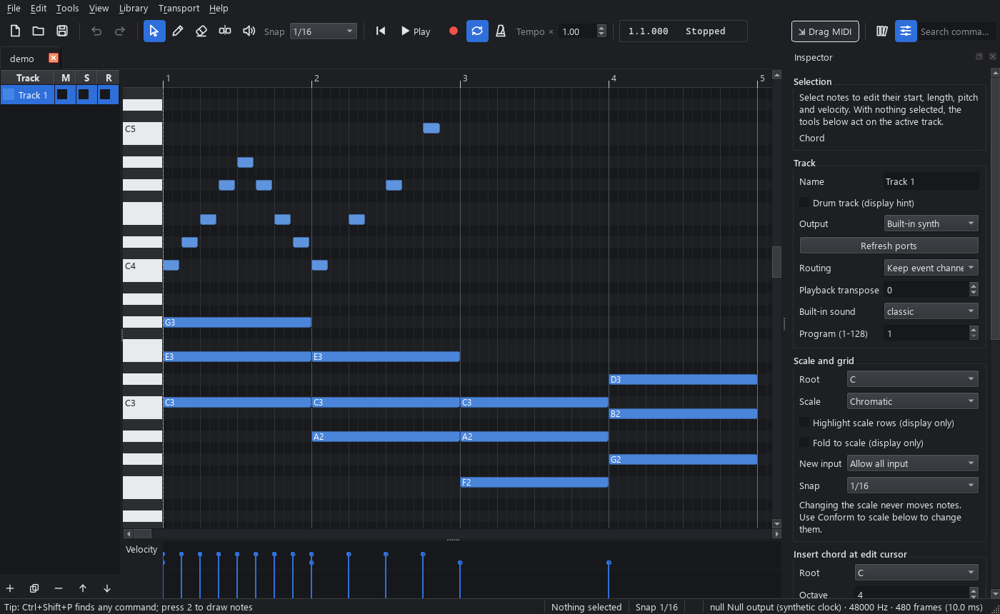

# MIDI Workbench

Find or create a musical idea, edit it comfortably, hear it immediately, save it without losing
anything, and reuse it in your DAW. MIDI Workbench is an offline Windows app for writing,
recording, organizing and searching MIDI. It needs no account and never goes online.

## What it does

- **Piano roll** with draw, select, erase, split and audition tools, velocity and controller lanes,
  a drum grid, an event list for exact edits, and unlimited undo.
- **Hear it right away** with the built-in synth (no SoundFont needed), or load your own `.sf2`
  bank for offline rendering from the command line. Export WAV at 16-bit, 24-bit or 32-bit float.
- **Play notes in** with the on-screen keyboard, your computer keyboard, or a MIDI keyboard. Record
  live with a count-in, or enter notes one step at a time.
- **Scales and chords**: highlight any of 19 scales (major, minor, the modes, harmonic and melodic
  minor, pentatonics, blues, whole tone, diminished and more) without ever changing your notes.
  Insert chords, see chord names for selected notes, and conform notes to a scale when you choose to.
- **Transform** a selection with quantize (strength and swing), humanize (repeatable with a seed),
  transpose by semitones or scale degrees, velocity and length tools, reverse, invert, strum,
  arpeggiate, Euclidean rhythms, groove, repeat and clean-up tools. Every tool previews first and
  undoes in one step.
- **Library**: add folders of MIDI files and keep browsing while they import. Files are copied into
  the library, so moving or deleting the originals does not lose them. Tag, rate, favorite, collect,
  keep revisions, and restore from the trash.
- **Search** by text and musical facts (`bpm:120..130 key:"A minor" tag:bass`) or by melody,
  including transposed melodies and similar phrases: select notes and choose **View > Find
  Selected Melody in Library** or **Find Similar Phrases**, or use `mwb-cli library melody`.
- **Safe files**: every save is atomic, unsaved work is recoverable after a crash, and exporting
  never changes your original files. "Original" export gives back the exact bytes you imported.

## Getting started

1. Run `MIDIWorkbench.exe`. A blank four-bar document opens (120 BPM, 4/4, PPQ 960).
2. Choose the **Draw** tool (the pencil on the toolbar, or press **2**) and click in the piano roll
   to add notes; drag to set their length. Double-click empty space in the Select tool to add a
   note too. The toolbar also holds the snap grid, transport, loop, metronome and a command search.
3. Press **Space** to play from the edit cursor and again to stop; the playhead returns to where
   playback started. **Ctrl+Space** pauses and resumes in place. The loop bracket in the ruler
   repeats the first four bars.
4. In the **Inspector**, pick a root and scale and tick **Highlight scale rows** to see the scale.
5. **File > Save** writes a `.mwb` document; **File > Export MIDI** writes a `.mid` for your DAW.
6. To build a library, open the Library panel (books icon or **Ctrl+1**), click **Create or Open
   Library…**, choose an empty folder, then **Add Folder…** to import your MIDI files.
7. **View > Theme** switches between Follow Windows, Dark, Light and High Contrast. **View > Note
   Colors** colors notes by track, channel, velocity or scale degree; note brightness follows
   velocity.

New documents can start from **Blank, Melody, Chords, Bassline** or **Drums** (File menu).

## Search cheat sheet

| Example | Finds |
|---|---|
| `tag:bass bpm:140..155` | items tagged *bass* with a tempo between 140 and 155 |
| `key:"F# minor" length.qn:8..32` | F# minor phrases 8 to 32 quarter notes long |
| `text:"rising lead" AND NOT drums:true` | text match without drum tracks |
| `has:bend AND duration:<30s` | items using pitch bend, shorter than 30 seconds |
| `(tag:melody OR tag:arpeggio) rating:>=4` | well-rated melodies or arpeggios |
| `tempo.any:140..160 tempo.origin:explicit` | any tempo in range, written in the file |

Other fields: `title:`, `notes:`, `tracks:`, `pitch.min:`/`pitch.max:` (numbers or names like
`C4`), `channel:` (1–16), `program:` (1–128), `role:`, `favorite:`, `meter:`, `status:`,
`source:`, `collection:`. Musical conditions in one AND group must hold in the same sequence of a
multi-sequence file.

## Keyboard shortcuts

| Keys | Action |
|---|---|
| Space | Play from the edit cursor / stop and return to where playback started |
| Ctrl+Space / Shift+Space | Pause and resume in place / play from the selection |
| Home / End | Go to the start / the end of the song (also while playing) |
| R | Record (with the count-in chosen in the Transport menu) |
| 1 / 2 / 3 / 4 / 5 | Select / Draw / Erase / Split / Audition tool |
| B | Toggle Draw and Select |
| Ctrl+1 / Ctrl+2 / Ctrl+3 | Show or hide Library / Inspector / Event List |
| Delete | Delete selected notes |
| Ctrl+Z / Ctrl+Y | Undo / redo |
| Ctrl+A | Select all |
| Ctrl+C / Ctrl+X / Ctrl+V | Copy / cut / paste at the edit cursor |
| Ctrl+D | Duplicate the selection right after itself |
| ← / → | Move the selected notes by one grid step; with nothing selected, move the play position like Ctrl+← / Ctrl+→ |
| Ctrl+← / Ctrl+→ | Move the play position (red line); Space then plays from there. The step follows the zoom (the smallest of grid step, beat, bar, 4 bars and 16 bars that is at least about 48 px wide) and grows while the key is held (one unit coarser after 0.4 s, two after 1.2 s). While playing, the playhead jumps |
| ↑ / ↓, Shift+↑ / Shift+↓ | Transpose by a semitone / an octave |
| Ctrl+↑ / Ctrl+↓ | Move by one degree of the scale |
| Q / Ctrl+Q | Apply last quantize / open the quantize tool |
| F | Fit selection (or everything) |
| Ctrl+F | Search the library |
| Ctrl+Shift+P | Command palette (every command and its shortcut) |
| Ctrl+S / Ctrl+Shift+S | Save / Save As |
| Ctrl+Shift+E | Export MIDI |
| F12 | Panic: stop every sounding note |
| Esc | Cancel the drag or tool in progress |

In the piano roll: mouse wheel scrolls pitch, Shift+wheel scrolls time, Ctrl+wheel zooms time,
Ctrl+Shift+wheel zooms pitch, middle-drag pans, Alt while dragging turns snapping off, Shift
while dragging locks to one direction, and Ctrl+drag copies the notes.

**Computer keyboard playing mode** (Tools menu): the keys A W S E D F T G Y H U J K play an
octave, Z/X change octave, C/V change velocity. Letter shortcuts are paused while it is on.

## Command line

`mwb-cli` inspects, validates, converts, transforms, renders and manages libraries without the
window. See [docs/COMMAND_LINE.md](docs/COMMAND_LINE.md).

## Good to know

- MIDI files hold performance data, not sound. How a file sounds depends on the synth or hardware
  that plays it.
- Changing the scale, highlighting or folding never moves a note. Only the explicit tools do.
- Nothing is sent to external MIDI hardware unless you choose an output for a track.
- MIDI Workbench is free software under the GNU GPL version 3. The About box lists every
  third-party library and its license.
